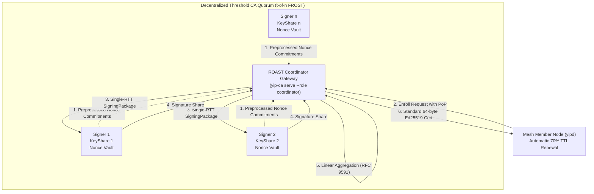

<div align="center">


# 🦊 yip

**Low-latency P2P mesh VPN in Rust.**<br/>
*Reed-Solomon FEC loss immunity • 40 Gbps AF_XDP multi-core scaling • Decentralized threshold PKI • Anti-DPI TLS mimicry*

<p align="center">
  <a href="https://crates.io/crates/yip-mesh"></a>
  <a href="https://docs.rs/yip-mesh"></a>
  <a href="https://github.com/femboyisp/yip/actions/workflows/ci.yml"></a>
  <a href="https://github.com/femboyisp/yip/actions/workflows/mutants.yml"></a>
  <a href="LICENSE"></a>
  <a href="https://www.rust-lang.org"></a>
  <a href="docs/01-getting-started.md"></a>
  <a href="bin/yipd/tests/run-multi-dpi-oracle.sh"></a>
</p>

<p align="center">
  
</p>

</div>

---

## What is yip?

Standard VPNs collapse the moment a physical link drops packets. WireGuard delivers exceptional throughput on clean fiber, but on lossy Wi-Fi, cellular networks, or congested trans-oceanic routes, even 2% packet loss forces TCP into exponential backoff, cutting effective speeds by up to 99%.

**yip fixes this at the root.** It is a high-performance peer-to-peer mesh VPN in Rust that bakes Reed-Solomon forward error correction (FEC) directly into the datapath. Missing packets are reconstructed in-flight before the kernel TCP stack or user applications ever realize a drop occurred.

Under the hood, yip pairs proactive loss recovery with **40 Gbps AF_XDP zero-copy scaling**, post-quantum **ML-KEM-512 handshakes**, an online ***t*-of-*n* Decentralized Threshold CA** (RFC 9591 FROST), and authentic **Chrome TLS mimicry** to glide past aggressive DPI firewalls unnoticed.

> [!TIP]
> **Decentralized Threshold CA Hero Feature**:
> yip avoids single-key CA failure by partitioning root signing authority across a distributed *t*-of-*n* signer quorum (`yip-ca serve`). Because FROST threshold signatures aggregate linearly into a standard 64-byte Ed25519 signature, threshold credentials require zero changes to node verifiers and support zero-touch 70% TTL auto-renewal inside `yipd`. See the turnkey [Threshold CA Quickstart](examples/threshold-ca/README.md).

> [!NOTE]
> yip builds an encrypted peer-to-peer overlay, not an anonymizing mix-net like Tor. Connected peers authenticate directly and see each other's physical IP addresses.

---

## Start Here

Find the fastest path to what you need:

| Persona | Immediate Next Steps | Recommended Guide |
| :--- | :--- | :--- |
| 🟢 **New User** | Install binary → Generate keypair → Connect two nodes → Ping overlay | [5-Minute Quickstart](#5-minute-quickstart) • [`01. Getting Started`](docs/01-getting-started.md) |
| 🌐 **Mesh Operator** | Choose deployment topology → Set up root CA / Threshold Quorum → Configure seeds | [Deployment Modes](#primary-deployment-modes) • [`Threshold CA Guide`](examples/threshold-ca/README.md) • [`02. Configuration`](docs/02-configuration.md) |
| 🛠️ **Developer** | Inspect lock-free ring buffers → Zero-alloc FEC pipeline → Run test suites | [`03. Architecture`](docs/03-architecture.md) • [`crates/yip-bench`](crates/yip-bench/RESULTS.md) |
| 🦀 **Rust Developer** | Import `yip-mesh` facade crate → Embed Cauchy RS-FEC or Noise-IK into custom apps | [Rust Library & SDK](#rust-library--sdk) • [`crates/yip-mesh`](crates/yip-mesh/README.md) • [docs.rs](https://docs.rs/yip-mesh) |
| 🛡️ **Security Reviewer** | Verify post-quantum hybrid KEM → ROAST threshold quorum → Anti-DPI test oracle | [Trust Model](#crisp-trust-model--security-invariants) • [`04. Security & Threat Model`](docs/04-security-and-threat-model.md) |

---

<a id="why-yip"></a>
## Why yip Exists: The Problem with Traditional VPNs

Every traditional tunnel protocol (WireGuard, OpenVPN, IPsec) makes an optimistic assumption: the underlying transport delivers packets reliably. On clean datacenter cross-connects, that assumption holds.

The open internet is not a clean datacenter cross-connect. On cellular data, satellite connections, crowded public Wi-Fi, or international transit routes, packet loss is an inescapable reality. When an underlying network drops packets, standard VPNs pass that loss straight up to the kernel. For TCP connections, this triggers catastrophic congestion window throttling modeled by Mathis' formula:

$$T \le \frac{MSS}{RTT} \times \frac{C}{\sqrt{p}}$$

Because throughput is inversely proportional to the square root of loss probability ($p$), injecting just 3% packet loss on a 100 Mbit/s link (60ms RTT) slashes transfer speeds from 95 Mbit/s down to under 10 Mbit/s. At 10% loss, connections stall completely.

**yip's answer is proactive in-flight repair.** Instead of waiting for timeout expirations and reactive retransmissions, yip computes Cauchy Reed-Solomon erasure coding over Galois Field $GF(2^8)$ directly in the datapath. For every block of packets, yip generates mathematical parity symbols in-flight. Missing symbols are reconstructed in **117 ns** with zero heap allocations before TCP stacks detect a gap.

---

## When to Choose yip

| Use yip for | Stick with WireGuard or others for |
| :--- | :--- |
| **Contended, lossy, or wireless links** (cellular, satellite, trans-oceanic transit) where packet drops stall standard tunnels | **Clean zero-loss gigabit LANs** where in-kernel WireGuard already saturates the wire with lower CPU overhead |
| **Zero-trust mesh networks** requiring decentralized *t*-of-*n* threshold signing and automated certificate renewal | **Simple point-to-point home VPNs** where static public keys are easily managed manually |
| **High-packet-rate 40G/100G edge infrastructure** scaling across multiple CPU cores via zero-copy AF_XDP | **Anonymity or mix-net routing** without trusted direct peering (peers authenticate directly) |
| **Hostile network environments** monitored by active-probing Deep Packet Inspection (DPI) firewalls | **Desktop platforms other than Linux** (macOS and Windows desktop clients are not currently supported) |
| **Future-proof quantum resistance** via NIST FIPS 203 ML-KEM-512 hybrid handshakes | Environments where legacy unencrypted protocols or centralized proprietary controllers are required |

---

## 5-Minute Quickstart

Set up an encrypted, forward-error-corrected tunnel between two Linux nodes in four steps:

```bash
# 1. Install binaries
cargo install yipd yip-ca
# Or automated installer: curl -fsSL https://raw.githubusercontent.com/femboyisp/yip/main/install.sh | sh
# Or pre-compiled binary: cargo binstall yipd yip-ca

# 2. Generate identity keypair and print self-certifying overlay IPv6 address
yipd --genkey > /etc/yip/node.key && yipd --addr $(grep '^public=' /etc/yip/node.key | cut -d= -f2)

# 3. Start the daemon (systemd service or direct configuration file invocation)
sudo systemctl start yipd
# Or run manually: sudo yipd /etc/yip/yipd.conf

# 4. Verify telemetry and ping remote overlay peer
yipctl status
ping6 <peer-overlay-ip>
```

---

## Primary Deployment Modes

### Mode 1: Direct Point-to-Point (VPS-to-VPS)
Direct UDP tunnel between two publicly addressable nodes with Cauchy RS-FEC:

```ini
# /etc/yip/yipd.conf (Host A: 198.51.100.1)
local_private = dd152fc311a115549005da852d101a7d3a14594c728f71ff87aa0872da6c0fa9
local_public  = bf923deeaddb66dde39e99987abdfd789c54eb882a570c340cd338071727ceeb
listen        = 0.0.0.0:443
device        = yip0

# Remote peer: Host B (203.0.113.2)
[peer]
public_key    = 1f5b6b76d9723a79221777a7450522c32faa7300efd59b0a5efa42665cac0a0a
endpoint      = 203.0.113.2:443
```

### Mode 2: NAT Rendezvous (Behind CGNAT)
Node behind NAT discovering and coordinating through an intermediate rendezvous relay:

```ini
# /etc/yip/yipd.conf (Node A behind CGNAT)
local_private = 2f2b5880cc15f29f826e876f5396c6f418e2366b73b415c5441f152b23c0334d
local_public  = 4cbc48cf095389d829abf3c7d78747ca35c96483375bd73860b2ebba94c99d50
listen        = 0.0.0.0:443
device        = yip0
rendezvous    = 198.51.100.5:443

# Remote peer: Node B (endpoint resolved dynamically via rendezvous)
[peer]
public_key    = 6ed3f82ba6450cd14ec52509deb42a87c6a8d2fa91a5a145f2ddcfdb0d675d12
```

### Mode 3: Zero-Trust Offline CA Mesh
Nodes discover and peer with authorized members automatically via signed gossip and rendezvous, requiring zero manual `[peer]` entries:

```ini
# /etc/yip/yipd.conf (Mesh Member Node)
local_private       = 2f2b5880cc15f29f826e876f5396c6f418e2366b73b415c5441f152b23c0334d
local_public        = 4cbc48cf095389d829abf3c7d78747ca35c96483375bd73860b2ebba94c99d50
listen              = 0.0.0.0:443
device              = yip0
rendezvous          = 198.51.100.5:443

# Offline CA credentials minted via `yip-ca sign-cert`
ca_public           = 8a03a4cf43c2907041efb394c0effabad5bdb4cbbc35d17c924c0b6cbfa8ba75
cert                = /etc/yip/node.cert
roots               = /etc/yip/network.roots
member_sign_private = c22239d00522843313aa03a662e8f0cb6abb7889f8f103510ebb5dee0e924857
network_id          = f11a8e0df8fa6352eeb62192de7ece47
```

### Mode 4: Decentralized Threshold CA Mesh (*t*-of-*n* FROST)
Eliminates single-point-of-compromise root keys. Online signers jointly issue and renew certificates via online RPC, with `yipd` handling zero-touch renewal in the background at 70% TTL:

```ini
# /etc/yip/yipd.conf (Enrolled Node with Automated Renewal)
ca_public           = 8a03a4cf43c2907041efb394c0effabad5bdb4cbbc35d17c924c0b6cbfa8ba75
cert                = /etc/yip/node.cert
roots               = /etc/yip/network.roots
member_sign_private = c22239d00522843313aa03a662e8f0cb6abb7889f8f103510ebb5dee0e924857
network_id          = f11a8e0df8fa6352eeb62192de7ece47

# Online Threshold CA Coordinator for background 70% TTL renewal
threshold_ca_server = 198.51.100.10:4443
```

Check status or trigger immediate renewal via the control socket:
```bash
sudo yipd cert status
sudo yipd cert renew
```

👉 **Complete deployment walk-through**: See the [Turnkey Threshold CA Tutorial & Systemd Units](examples/threshold-ca/README.md).

---

## Comprehensive 6-Pillar Feature Showcase

### 1. Galois Field Proactive FEC
- **Systematic Cauchy RS + RLNC Streaming**: In-flight erasure coding over $GF(2^8)$ pairs Cauchy Reed-Solomon block codes with Random Linear Network Coding streaming fountain codes.
- **Poly-Vector SIMD Acceleration**: Hardware-accelerated matrix multiplication across AVX-512BW, Intel GFNI, AVX2, SSSE3, ARM NEON, and WebAssembly SIMD128.
- **Adaptive Repair Scaling**: Real-time sliding window telemetry dynamically adjusts repair symbol overhead based on observed channel loss, eliminating goodput waste on clean links.
- **Zero-Allocation Hot-Path Reassembly**: Pre-allocated contiguous object buffers and in-place Cauchy RS repair (`reconstruct_missing_sources`) deliver clean packets in **117 ns** with zero heap allocations.

### 2. Zero-Trust PKI & Decentralized Mesh Membership
- **Dual Cryptographic CA Architecture**: Supports both an air-gapped, offline master key root CA (`yip-ca sign-cert`) and an online, decentralized ***t*-of-*n* Threshold CA** (`yip-ca serve --role coordinator|signer`).
- **RFC 9591 FROST Ed25519 Quorum**: Threshold signers collaborate using the FROST(Ed25519, SHA-512) ciphersuite. Because Schnorr threshold signatures aggregate linearly into a standard 64-byte Ed25519 signature, threshold credentials are 100% byte-for-byte indistinguishable from single-signer certificates, requiring zero changes to existing node verifiers.
- **Single-Round (1-RTT) Online Enrollment**: Pre-generated nonce pools (`frost_ed25519::round1::preprocess`) pre-cached at the coordinator collapse online certificate enrollment from two network round-trips to a single RPC round-trip.
- **Asynchronous Robustness (ROAST)**: Coordinator signing loop is wrapped in a ROAST state machine, guaranteeing progress and unforgeable issuance even if up to *n* - *t* signers are unresponsive, delayed, or Byzantine.
- **Rollback-Immune Nonce Vault**: Memory-locked (`mlock`), zeroized-on-drop ephemeral nonce pools bound to 128-bit CSPRNG boot-epoch IDs eliminate nonce-reuse private key extraction under VM snapshots.
- **Automated Lifecycle & Background Renewal**: Proactive zero-knowledge polynomial share refreshing (CVE-2025-58359 hardened), lost-share repair, and automated zero-touch renewal inside `bin/yipd` at ≥ 70% of certificate TTL.



### 3. Kernel-Bypass Performance
- **Zero-Copy AF_XDP (XSK)**: Direct UMEM memory ring driver with per-core slab partitioning and lock-free ring recycling bypasses the Linux network stack, sustaining 40.27 Gbps and 3.93 Mpps across 8 CPU cores.
- **Asynchronous `io_uring`**: High-performance multishot ring polling drives high packet rates without thread contention or syscall overhead.
- **Multi-Queue TUN Sharding**: `IFF_MULTI_QUEUE` worker isolation maps packet flows to dedicated CPU cores via lock-free SPSC ring buffers.
- **Vectorized Socket I/O**: Batched `recvmmsg` and `sendmmsg` (tunable 32/64/128-packet bursts) with `UDP_SEGMENT` Generic Segmentation Offload (GSO) optimize standard POSIX network paths.
- **Flat Open-Addressing Tables**: Replaces dynamic pointer maps with bounded flat slot tables using SplitMix64 fast hashing and backward-shift deletion with zero tombstones.

### 4. Post-Quantum Cryptography & Identity
- **Single-RTT Hybrid Handshake**: Blends Noise_IKpsk2 (Curve25519) with NIST FIPS 203 ML-KEM-512 (Kyber) within compact datagrams strictly under the 1200-byte internet MTU floor.
- **120-Second Epoch Ratcheting**: Automated forward-secrecy key rotation with a 20-second dual-receive grace window prevents dropped packets during rekey transitions.
- **Rigorous Memory Hygiene**: Cryptographic secrets implement explicit `Zeroize` traits to purge private key material from memory buffers immediately upon drop.
- **Self-Certifying IPv6 Addressing**: Cryptographic BLAKE2s-120 hashing derives immutable, anti-spoofing overlay addresses in the `fd00::/8` ULA space directly from node public keys.

### 5. 4-Mode Anti-DPI Armor
- **`raw-obf`**: SipHash-CTR keystream masking with a 64-bit SipHash-1-3 coverage authentication tag strips all fixed wire headers, leaving uniform high-entropy payload noise.
- **`quic` Masquerade**: Encapsulates tunnel traffic inside standard RFC 9221 HTTP/3 datagrams indistinguishable from ordinary web media traffic.
- **`tls` Emulation**: Authentic TLS 1.3 framing paired with uTLS Google Chrome ClientHello fingerprints evades SNI inspection and protocol whitelisting.
- **`relay` (REALITY)**: Advanced certificate borrowing and transparent TCP splicing forward unauthorized probes to authentic upstream target servers.
- **DAITA Cover Defense**: Discrete packet-length bucketing and randomized decoy traffic defeat statistical packet-size analysis and website fingerprinting.
- **4-Engine DPI Oracle Verified**: Continuously tested and verified clean against nDPI, Zeek, Suricata, and Wireshark inspection rules.

### 6. NAT Traversal & Blind Relays
- **STUN UDP Hole-Punching**: Embedded STUN resolver discovers public reflexive mappings and classifies symmetric, full-cone, and port-restricted NAT topologies.
- **Zero-Knowledge Blind Relays**: Untrusted rendezvous nodes (`yip-rendezvous`) relay encrypted envelopes without possessing decryption keys or inspecting packet contents.
- **Seamless Roaming**: Cryptographic session binding automatically maintains connection state when roaming between Wi-Fi, Ethernet, and cellular interfaces.
- **Headless Daemon Control**: Full management and real-time observability over a protected UNIX domain control socket using the `yipctl` command-line utility.

---

## Performance & Benchmark Highlights

Deterministic benchmarks measured across multi-region cloud WANs (AWS `us-east-1` to `us-west-2`, ~58ms RTT) and multi-core edge hardware:

<p align="center">
  
  
</p>

- **173× throughput advantage at 10% packet loss**: Sustains **86.6 Mbit/s** goodput where WireGuard collapses to **0.5 Mbit/s**.
- **193× throughput advantage at 3% loss**: Delivers **251.3 Mbit/s** compared to WireGuard's **1.3 Mbit/s**.
- **40.27 Gbps line-rate scaling**: Scales across 8 CPU cores (3.93 Mpps) using zero-copy AF_XDP and lock-free SPSC queues.
- **Flat ~60ms P99 latency**: In-flight symbol reconstruction eliminates TCP head-of-line blocking and retransmission spikes across 0% to 10% packet loss.

> [!NOTE]
> **How to Interpret Benchmark Results**:
> On clean, zero-loss LANs or dedicated datacenter links, in-kernel WireGuard already saturates the wire with minimal CPU overhead. `yip` deliberately trades a minor fraction of clean-path CPU to compute in-flight Reed-Solomon parity symbols. The payoff appears under real-world internet transit conditions: while traditional tunnels trigger TCP window backoff and stall, `yip` sustains high goodput and flat latency.

<details>
<summary><b>Click to expand raw automated WAN benchmark data table</b></summary>

<!-- BENCHMARK-TABLE-START -->

<!-- generated by crates/yip-bench/wan/collect.sh -->
*Two 1-vCPU Debian 13 VPSes, ~54.365 ms apart, 2026-10-27. yip trades raw clean-path throughput for loss resilience (see the FEC row).*

| | TCP 1-stream | UDP loss (200M) | effective loss @10% injected |
|---|--:|--:|--:|
| **yip** | 253.7 Mbit/s | 0.00% | 0% |
| **WireGuard** | 453.1 Mbit/s | 0.00% | 7% |
| **OpenVPN** | 32.6 Mbit/s | 0.04% | 8% |

<!-- BENCHMARK-TABLE-END -->

</details>

Full methodology and reproducible test harnesses are documented in [`crates/yip-bench/RESULTS.md`](crates/yip-bench/RESULTS.md) and [`05. Benchmarks & Performance`](docs/05-benchmarking-and-performance.md).

---

## Crisp Trust Model & Security Invariants

`yip` is built on explicit, verifiable security boundaries:

```
┌───────────────────────────────────────┬───────────────────────────────────────┐
│           WHAT IS PROTECTED           │         WHAT IS NOT PROTECTED         │
├───────────────────────────────────────┼───────────────────────────────────────┤
│ ✔ Payload Confidentiality & Integrity │ ✘ Physical Peer IP Concealment        │
│   ChaCha20-Poly1305 with post-quantum │   Peers authenticate directly and     │
│   hybrid ML-KEM-512 forward secrecy   │   exchange traffic peer-to-peer       │
├───────────────────────────────────────┼───────────────────────────────────────┤
│ ✔ Single-Point-of-Failure CA Defense  │ ✘ Mix-Net Anonymity                   │
│   t-of-n FROST quorum ensures master  │   yip is not Tor; it does not route   │
│   private key never exists on 1 host  │   through multi-hop onion circuits    │
├───────────────────────────────────────┼───────────────────────────────────────┤
│ ✔ Probe Resistance & DPI Bypass       │ ✘ Covert Timing on Raw UDP            │
│   REALITY splices active probers into │   Without DAITA padding enabled,      │
│   authentic CDNs (Apple/Microsoft)    │   packet timing mirrors traffic flows │
├───────────────────────────────────────┼───────────────────────────────────────┤
│ ✔ Replay & Identity Spoofing          │ ✘ Subverted Host Kernels              │
│   TAI64N monotonic freshness and      │   The daemon relies on Linux memory   │
│   BLAKE2s cryptographic addressing    │   isolation and privileged namespaces │
└───────────────────────────────────────┴───────────────────────────────────────┘
```

- **Threshold Signature Security**: An adversary compromising fewer than *t* signers obtains zero knowledge of the master CA private scalar.
- **Rollback Immunity**: Ephemeral nonces in `EphemeralNonceVault` are memory-locked (`mlock`) and consumed via atomic single-use primitives to eliminate nonce-reuse private key extraction under VM snapshots.
- **Identifiable Aborts (ROAST)**: Honest coordinators pinpoint dishonest signers and continue signing without denial-of-service stalls.

---

## Documentation Curriculum

Explore the full documentation curriculum organized by role and interest:

| Guide | Target Audience | Primary Focus |
| :--- | :--- | :--- |
| [`01. Getting Started`](docs/01-getting-started.md) | **Beginner / Operator** | Platform requirements, installation, first tunnel setup, and CA mesh bootstrap |
| [`02. Configuration Reference`](docs/02-configuration.md) | **Operator / Admin** | Comprehensive parameter reference, deployment recipes, and `yipctl` command guide |
| [`03. Architecture & Internals`](docs/03-architecture.md) | **Developer / Architect** | Control vs data plane, zero-copy AF_XDP queues, Cauchy RS-FEC, and FROST threshold CA |
| [`04. Security & Threat Model`](docs/04-security-and-threat-model.md) | **Security Reviewer** | Post-quantum hybrid handshake, adversary model, anti-DPI verification, and crypto ledger |
| [`05. Benchmarks & Performance`](docs/05-benchmarking-and-performance.md) | **Researcher / Tester** | Real-world WAN test data, multi-core scaling charts, loss-recovery mathematical proofs |
| [`06. Troubleshooting Runbook`](docs/06-troubleshooting.md) | **Operator / SRE** | Diagnostic flowcharts, MTU discovery issues, NAT traversal debugging, and telemetry inspection |
| [`Motivation & Philosophy`](docs/motivation.md) | **Everyone** | Design philosophy, anti-censorship regulatory context, and the problem with traditional VPNs |
| [`Turnkey Threshold CA Tutorial`](examples/threshold-ca/README.md) | **Operator** | Step-by-step setup of a 2-of-3 threshold CA quorum with systemd units |

---

## Rust Library & SDK

The `yip` workspace publishes a unified facade crate [`yip-mesh`](crates/yip-mesh) for embedding yip's primitives directly into your Rust applications:

```toml
[dependencies]
yip-mesh = { version = "0.1", features = ["full"] }
```

### Modular Feature Flags

- **`crypto`** (default): AEAD ciphers (ChaCha20-Poly1305, AES-256-GCM, AES-128-GCM), Noise-IK handshakes, BLAKE2s hashing, and key derivations.
- **`wire`** (default): Zero-allocation framing, wire codec parsing, header obfuscation, and control frame encoding.
- **`transport`** (default): Slotted Reed-Solomon Forward Error Correction (FEC), sliding window packet reassembly, and selective ARQ.
- **`membership`** (default): Cryptographic node identity, self-certifying IPv6 mesh addresses, certificate verification, root sets, and anti-entropy gossip.
- **`device`**: TUN/TAP virtual network device abstractions across Linux.
- **`io`**: High-throughput I/O engines supporting Linux `epoll` and `io_uring` with ring buffer pools.
- **`rendezvous`**: STUN/TURN-independent symmetric NAT traversal with authenticated ticket exchange.
- **`obf`**: Steganographic wire framing, padding transforms, and timing-jitter obfuscation.
- **`utls`**: TLS 1.3 browser mimicry and REALITY camouflage transport.
- **`ca`**: RFC 9591 FROST threshold certificate authority signer and coordinator protocols.
- **`full`**: Enables all modules above.

---

## License

Copyright © 2026 FEMBOY CYBER NETWORKS LLC.

Licensed under the [GNU Affero General Public License v3.0 or later](LICENSE) (`AGPL-3.0-or-later`).
