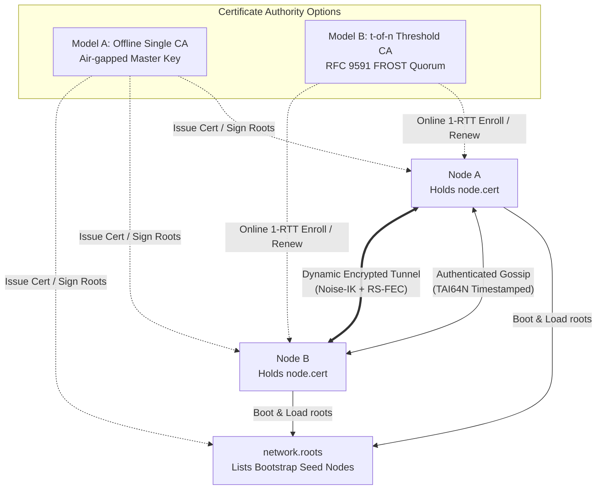

# Getting Started with yip

This guide walks through system requirements, installation workflows, production init service integration, and a complete end-to-end tutorial to establish your first encrypted, forward-error-corrected `yip` tunnel between two Linux hosts.

For comprehensive configuration directives and wire protocol internals, refer to:
- [configuration.md](configuration.md): Exhaustive configuration syntax and option reference.
- [architecture.md](architecture.md): System architecture, packet pipeline, and crypto engine.
- [user-guide.md](user-guide.md): Advanced topologies, NAT traversal, and mesh operation.

---

## Table of Contents

- [1. Prerequisites & System Assumptions](#1-prerequisites--system-assumptions)
  - [Supported Platforms](#supported-platforms)
  - [Privileges & Linux Capabilities](#privileges--linux-capabilities)
  - [Kernel Requirements Matrix](#kernel-requirements-matrix)
- [2. Installation Methods](#2-installation-methods)
  - [Option A: Automated POSIX Installer](#option-a-automated-posix-installer)
  - [Option B: Pre-Compiled Binaries via cargo-binstall](#option-b-pre-compiled-binaries-via-cargo-binstall)
  - [Option C: Building from Source](#option-c-building-from-source)
  - [Option D: Container / Docker Deployment](#option-d-container--docker-deployment)
  - [Control Utility Symlink (yipctl)](#control-utility-symlink-yipctl)
- [3. Init Service Integration](#3-init-service-integration)
  - [systemd](#systemd)
  - [OpenRC](#openrc)
  - [runit](#runit)
- [4. End-to-End First Tunnel Tutorial](#4-end-to-end-first-tunnel-tutorial)
  - [Topology Overview](#topology-overview)
  - [Step 1: Generate Node Keypairs](#step-1-generate-node-keypairs)
  - [Step 2: Derive Mesh IPv6 Addresses](#step-2-derive-mesh-ipv6-addresses)
  - [Step 3: Configure Host A](#step-3-configure-host-a)
  - [Step 4: Configure Host B](#step-4-configure-host-b)
  - [Step 5: Start the Daemon](#step-5-start-the-daemon)
  - [Step 6: Configure Network Interfaces & Addressing](#step-6-configure-network-interfaces--addressing)
  - [Step 7: Verify Connectivity & Telemetry](#step-7-verify-connectivity--telemetry)
- [5. Zero-Trust Mesh with yip-ca](#5-zero-trust-mesh-with-yip-ca)
  - [Step 1: Initialize the Offline Root CA](#step-1-initialize-the-offline-root-ca)
  - [Step 2: Generate Node Keys](#step-2-generate-node-keys)
  - [Step 3: Issue Member Certificates](#step-3-issue-member-certificates)
  - [Step 4: Create and Sign the Bootstrap Root Set](#step-4-create-and-sign-the-bootstrap-root-set)
  - [Step 5: Configure Mesh Node](#step-5-configure-mesh-node)
  - [Step 6: Start and Verify Dynamic Mesh Convergence](#step-6-start-and-verify-dynamic-mesh-convergence)
- [6. Troubleshooting & Common Pitfalls](#6-troubleshooting--common-pitfalls)

---

## 1. Prerequisites & System Assumptions

### Supported Platforms

`yip` is built specifically for Linux kernel networking primitives (TUN/TAP, multi-queue sockets, vectorized I/O, io_uring, and AF_XDP):

- **Target OS**: Linux (glibc 2.31+ or musl 1.2+)
- **Architectures**:
  - `x86_64` (AMD64 / Intel 64) with AVX2 support recommended for hardware-accelerated Reed-Solomon FEC
  - `aarch64` (ARM64 / ARMv8-A+) with NEON vector instructions
  - `armv7` (ARM 32-bit with VFPv4/NEON)

### Privileges & Linux Capabilities

`yipd` creates virtual network interfaces (`/dev/net/tun`) and binds raw / low-numbered network ports. While running as `root` is supported, running unprivileged with bounded Linux capabilities is recommended for production security:

| Capability | Purpose |
| :--- | :--- |
| `CAP_NET_ADMIN` | Create, configure, and manipulate TUN/TAP devices and interface IP addresses |
| `CAP_NET_RAW` | Bind raw network sockets and construct low-overhead frames |
| `CAP_BPF` | Load and attach eBPF programs for socket steering and packet classification |
| `CAP_IPC_LOCK` | Lock memory pages (`mlock`) required for AF_XDP (UMEM) rings and io_uring buffers |

> [!IMPORTANT]
> **Locked Memory Limit (`LimitMEMLOCK` / `ulimit -l`):**
> High-performance socket datapaths (io_uring and AF_XDP zero-copy) allocate non-swappable pinned memory buffers. Ensure your user environment or service unit sets locked memory to unlimited (`LimitMEMLOCK=infinity` in systemd or `ulimit -l unlimited` in shell profiles).

To assign capabilities to the binary directly on systems without init capability management:

```sh
sudo setcap 'cap_net_admin,cap_net_raw,cap_bpf,cap_ipc_lock+ep' /usr/local/bin/yipd
```

### Kernel Requirements Matrix

`yip` dynamically scales its socket transport depending on the host kernel version:

| Kernel Version | Datapath Driver | Capability / Feature Set |
| :--- | :--- | :--- |
| **Linux 5.15+** | Vectorized Sockets | Baseline datapath. Uses `recvmmsg(2)` and `sendmmsg(2)` with `UDP_SEGMENT` Generic Segmentation Offload (GSO). |
| **Linux 6.1+** *(Recommended)* | `io_uring` / `AF_XDP` SKB | Kernel-bypass packet I/O, asynchronous completion rings, and copy-mode XSK packet steering across worker shards. |
| **Linux 6.6+** | `AF_XDP` Hardware Zero-Copy | Hardware zero-copy descriptor exchange directly between supported NIC drivers and userspace UMEM rings. |

---

## 2. Installation Methods

### Option A: Automated POSIX Installer

The official installer detects your architecture, verifies SHA-256 release checksums, places binaries in `/usr/local/bin`, seeds configuration examples in `/etc/yip/`, and registers init services for detected init managers ([install.sh](../install.sh)):

```sh
curl -fsSL https://raw.githubusercontent.com/femboyisp/yip/main/install.sh | sh
```

To run non-interactively or customize destination paths:

```sh
curl -fsSL https://raw.githubusercontent.com/femboyisp/yip/main/install.sh | \
  BINDIR=/usr/local/bin CONFDIR=/etc/yip INIT_SYSTEM=systemd sh
```

### Option B: Pre-Compiled Binaries via cargo-binstall

If you have Rust tools and [`cargo-binstall`](https://github.com/cargo-bins/cargo-binstall) installed:

```sh
cargo binstall yipd yip-ca yip-rendezvous
```

### Option C: Building from Source

#### Build Prerequisites
- **Rust Toolchain**: Stable 1.85+ (`rustup update stable`)
- **C Compiler & Build Tools**: `gcc` or `clang`, `make`, `cmake` (required by BoringSSL bindings in the TLS mimicry engine), and `musl-tools` if targeting static musl binaries.

#### Clone and Compile

```sh
# 1. Clone repository
git clone https://github.com/femboyisp/yip.git
cd yip

# 2. Compile release binaries with all workspace members
cargo build --release --workspace

# 3. Install binaries to system path
sudo install -m 0755 target/release/yipd /usr/local/bin/yipd
sudo install -m 0755 target/release/yip-ca /usr/local/bin/yip-ca
sudo install -m 0755 target/release/yip-rendezvous /usr/local/bin/yip-rendezvous

# 4. Prepare configuration directory
sudo mkdir -p /etc/yip
sudo cp example.config /etc/yip/yipd.conf.example
```

> [!TIP] Clever Fox Tip: Always Build in Release Mode
> Always compile with `--release`. Unoptimized debug builds run the Galois field GF(256) Reed-Solomon matrix routines in software without SIMD autovectorization, resulting in substantially higher CPU latency.

### Option D: Container / Docker Deployment

For containerized environments, run `yipd` with network administration privileges and TUN device access:

```sh
docker run -d \
  --name yipd \
  --restart unless-stopped \
  --network host \
  --cap-add=NET_ADMIN \
  --cap-add=NET_RAW \
  --cap-add=BPF \
  --cap-add=IPC_LOCK \
  --device /dev/net/tun:/dev/net/tun \
  -v /etc/yip:/etc/yip:ro \
  ghcr.io/femboyisp/yip:latest
```

### Control Utility Symlink (`yipctl`)

The `yipd` binary contains built-in daemon management and telemetry client commands. When invoked as `yipctl`, it automatically switches into client control mode. Create a symlink to enable `yipctl`:

```sh
sudo ln -sf /usr/local/bin/yipd /usr/local/bin/yipctl
```

You can now use `yipctl status`, `yipctl peers`, and `yipctl top` directly from your shell.

---

## 3. Init Service Integration

Production service configurations for `systemd`, `OpenRC`, and `runit` are provided in the [`contrib/`](../contrib/) directory.

### systemd

The provided systemd service file ([contrib/systemd/yipd.service](../contrib/systemd/yipd.service)) enforces strict sandbox protections and ambient capabilities:

```ini
[Unit]
Description=yip high-performance obfuscated mesh VPN daemon
After=network.target network-online.target
Wants=network-online.target
Documentation=https://github.com/femboyisp/yip

[Service]
Type=simple
ExecStart=/usr/local/bin/yipd /etc/yip/yipd.conf
Restart=always
RestartSec=3s

# Privileges and capabilities
CapabilityBoundingSet=CAP_NET_ADMIN CAP_NET_RAW CAP_BPF CAP_IPC_LOCK
AmbientCapabilities=CAP_NET_ADMIN CAP_NET_RAW CAP_BPF CAP_IPC_LOCK
LimitMEMLOCK=infinity

# Device permissions
DeviceAllow=/dev/net/tun rw

# Sandboxing and filesystem protection
ProtectSystem=strict
ProtectHome=true
NoNewPrivileges=true
PrivateTmp=true
ProtectControlGroups=true
ProtectKernelModules=true
ProtectKernelLogs=true
RestrictRealtime=true
LockPersonality=true
MemoryDenyWriteExecute=true
RestrictNamespaces=false

# Runtime and configuration directories
RuntimeDirectory=yipd
ConfigurationDirectory=yip

[Install]
WantedBy=multi-user.target
```

#### Activation
```sh
sudo cp contrib/systemd/yipd.service /etc/systemd/system/yipd.service
sudo systemctl daemon-reload
sudo systemctl enable yipd
```

### OpenRC

For Alpine Linux and Gentoo systems using OpenRC ([contrib/openrc/yipd](../contrib/openrc/yipd)):

```sh
#!/sbin/openrc-run
name="yipd"
description="yip high-performance obfuscated mesh VPN daemon"

command="/usr/local/bin/yipd"
command_args="${YIPD_CONF:-/etc/yip/yipd.conf}"
supervisor="supervise-daemon"
capabilities="^cap_net_admin,^cap_net_raw,^cap_bpf,^cap_ipc_lock"

rc_ulimit="-l unlimited"

depend() {
	need net
	after firewall
	use dns
}

start_pre() {
	checkpath -d -m 0755 /run/yipd
	if [ ! -f "${command_args}" ]; then
		eerror "Config file ${command_args} not found!"
		return 1
	fi
}
```

#### Activation
```sh
sudo cp contrib/openrc/yipd /etc/init.d/yipd
sudo chmod 0755 /etc/init.d/yipd
sudo rc-update add yipd default
```

### runit

For Void Linux or runit containers ([contrib/runit/yipd/run](../contrib/runit/yipd/run)):

```sh
#!/bin/sh
exec 2>&1

ulimit -l unlimited 2>/dev/null || true

mkdir -p /run/yipd
chmod 0755 /run/yipd

CONF="${YIPD_CONF:-/etc/yip/yipd.conf}"

exec /usr/local/bin/yipd "$CONF"
```

#### Activation
```sh
sudo mkdir -p /etc/sv/yipd
sudo cp contrib/runit/yipd/run /etc/sv/yipd/run
sudo chmod 0755 /etc/sv/yipd/run
sudo ln -s /etc/sv/yipd /var/service/
```

---

## 4. End-to-End First Tunnel Tutorial

This walkthrough sets up a direct, point-to-point encrypted tunnel between two distinct servers across the public internet.

### Topology Overview

```
+-----------------------------------+              +-----------------------------------+
|              HOST A               |              |              HOST B               |
| Public IP:  198.51.100.1          |              | Public IP:  203.0.113.2           |
| Overlay IP: fd00:1::1/64          | <==========> | Overlay IP: fd00:1::2/64          |
| Tunnel Dev: yip0 (L3 TUN)         |  Encrypted   | Tunnel Dev: yip0 (L3 TUN)         |
| Listen:     0.0.0.0:443           |     UDP      | Listen:     0.0.0.0:443           |
+-----------------------------------+              +-----------------------------------+
```

### Step 1: Generate Node Keypairs

`yip` uses Noise IKpsk2 with 25519 static keys (32-byte / 64 hex characters). Generate a fresh keypair on **both** Host A and Host B using `yipd --genkey` (or `yipctl genkey`):

#### On Host A:
```sh
yipd --genkey
```
*Example Output:*
```text
private=e81d76326087b220d3f237ef39aa4d91361ff55b7661005a7657d23d8c117d4a
public=7df4d68205f03a2cae7e1713444fcda80ff43a29de7e9b0b4b2c159286d9a11a
```

#### On Host B:
```sh
yipd --genkey
```
*Example Output:*
```text
private=50b522bb0b57e7eb133e9b11b5275ea011cf8c3f4e24eb37452d192131b0e01c
public=9b49ffeb4566b53a0f78cae08920bc9e30a6e0c60f252cfdf4740e74f8c92b21
```

> [!CAUTION]
> Never share or commit `private` keys. Store them in files readable only by `root` (mode `0600`).

---

### Step 2: Derive Mesh IPv6 Addresses

`yip` features self-certifying IPv6 addresses: a node's overlay address is derived directly from its public key (`0xfd || BLAKE2s(DOMAIN || pubkey)[..15]`). You can derive this address via `--addr`:

#### On Host A:
```sh
yipd --addr 7df4d68205f03a2cae7e1713444fcda80ff43a29de7e9b0b4b2c159286d9a11a
# Output: fd6a:9b12:ec41:882b:9912:65aa:1204:88ef
```

#### On Host B:
```sh
yipd --addr 9b49ffeb4566b53a0f78cae08920bc9e30a6e0c60f252cfdf4740e74f8c92b21
# Output: fdb2:44cc:701a:32aa:01aa:89fe:412b:7710
```

You can choose either standard custom ULA prefixes (such as `fd00:1::1/64`) or these self-certifying key addresses for your overlay. For this tutorial, we will assign `fd00:1::1/64` to Host A and `fd00:1::2/64` to Host B.

> [!TIP] Clever Fox Tip: Self-Certifying Addressing
> Because your overlay IPv6 is cryptographically bound to your public key, peers can verify your identity without consulting a centralized directory or authority. If an incoming packet doesn't match its cryptographic origin, yip quietly drops it in its tracks.

---

### Step 3: Configure Host A

Create the configuration file at `/etc/yip/yipd.conf` on **Host A**:

```ini
# /etc/yip/yipd.conf on Host A (198.51.100.1)

# Local identity
local_private=e81d76326087b220d3f237ef39aa4d91361ff55b7661005a7657d23d8c117d4a
local_public=7df4d68205f03a2cae7e1713444fcda80ff43a29de7e9b0b4b2c159286d9a11a

# Socket binding & network device
listen=0.0.0.0:443
device=yip0
device_kind=tun

# Local control socket
control_socket=/run/yipd/yipd.sock

# Remote peer: Host B
[peer]
public_key=9b49ffeb4566b53a0f78cae08920bc9e30a6e0c60f252cfdf4740e74f8c92b21
endpoint=203.0.113.2:443
```

Secure the permissions:
```sh
sudo chmod 0600 /etc/yip/yipd.conf
```

---

### Step 4: Configure Host B

Create the matching configuration file at `/etc/yip/yipd.conf` on **Host B**:

```ini
# /etc/yip/yipd.conf on Host B (203.0.113.2)

# Local identity
local_private=50b522bb0b57e7eb133e9b11b5275ea011cf8c3f4e24eb37452d192131b0e01c
local_public=9b49ffeb4566b53a0f78cae08920bc9e30a6e0c60f252cfdf4740e74f8c92b21

# Socket binding & network device
listen=0.0.0.0:443
device=yip0
device_kind=tun

# Local control socket
control_socket=/run/yipd/yipd.sock

# Remote peer: Host A
[peer]
public_key=7df4d68205f03a2cae7e1713444fcda80ff43a29de7e9b0b4b2c159286d9a11a
endpoint=198.51.100.1:443
```

Secure the permissions:
```sh
sudo chmod 0600 /etc/yip/yipd.conf
```

---

### Step 5: Start the Daemon

#### Using systemd:
```sh
# On Host A and Host B
sudo systemctl restart yipd
sudo systemctl status yipd
```

#### Running in foreground (for testing/diagnostics):
```sh
sudo yipd /etc/yip/yipd.conf
```

Once started, `yipd` creates the virtual network interface `yip0`.

---

### Step 6: Configure Network Interfaces & Addressing

Assign the overlay IPv6 addresses and bring up the `yip0` interfaces:

#### On Host A:
```sh
sudo ip -6 addr add fd00:1::1/64 dev yip0
sudo ip link set yip0 up
```

#### On Host B:
```sh
sudo ip -6 addr add fd00:1::2/64 dev yip0
sudo ip link set yip0 up
```

*(Optional: If IPv4 overlay is preferred, you may assign `10.7.0.1/24` on Host A and `10.7.0.2/24` on Host B).*

---

### Step 7: Verify Connectivity & Telemetry

#### 1. Check Daemon State
Query the local daemon status via `yipctl status`:

```sh
sudo yipctl status
```
*Output:*
```text
Daemon Status: RUNNING
Interface:     yip0 (tun)
Listen:        0.0.0.0:443
Active Peers:  1
Worker Shards: 1
```

#### 2. Inspect Connected Peers & FEC Telemetry
Inspect handshake status, session counters, and Reed-Solomon recovery metrics:

```sh
sudo yipctl peers
```
*Output:*
```text
PEER: 9b49ffeb4566b53a...
  Endpoint:       203.0.113.2:443 (Direct)
  Handshake:      Completed (authenticated via Noise_IKpsk2)
  Rekey:          In 114s (epoch 1)
  Tx Packets:     42 (6.2 KiB)
  Rx Packets:     38 (5.8 KiB)
  FEC Data/Par:   (8, 2)
  Recovered Pkts: 0
```

#### 3. Test Overlay Connectivity
Ping Host B from Host A over the encrypted tunnel:

```sh
ping6 -c 4 fd00:1::2
```
*Output:*
```text
PING fd00:1::2(fd00:1::2) 56 data bytes
64 bytes from fd00:1::2: icmp_seq=1 ttl=64 time=14.2 ms
64 bytes from fd00:1::2: icmp_seq=2 ttl=64 time=13.9 ms
64 bytes from fd00:1::2: icmp_seq=3 ttl=64 time=14.1 ms
64 bytes from fd00:1::2: icmp_seq=4 ttl=64 time=14.0 ms

--- fd00:1::2 ping statistics ---
4 packets transmitted, 4 received, 0% packet loss, time 3004ms
rtt min/avg/max/mdev = 13.914/14.052/14.218/0.112 ms
```

#### 4. Real-time ANSI Telemetry Dashboard
Launch the interactive live terminal dashboard to observe throughput and real-time FEC packet recovery:

```sh
sudo yipctl top
```

---

## 5. Zero-Trust Mesh with yip-ca

In the point-to-point setup in Section 4, each node required an explicit `[peer]` block defining the remote public key and endpoint. While simple for two nodes, configuring and distributing static peer blocks across dozens or hundreds of nodes becomes an operational headache.

**Mesh mode solves this with zero-trust cryptographic admission.** Instead of maintaining static peer lists, nodes dynamically discover authorized members and establish point-to-point tunnels on demand. `yip` provides two CA models:
- **Model A: Offline Single-Key Root CA**: For air-gapped root-of-trust deployments where certificates and root sets are minted manually.
- **Model B: Decentralized Threshold CA (*t*-of-*n* FROST)**: For online, automated environments where signing authority is distributed across a quorum of independent signer daemons, with 1-RTT enrollment and automated background renewal in `yipd`.



---

### Model A: Offline Root CA Workflow

#### Step 1: Initialize the Offline Root CA

Run `yip-ca genkey` on a secure management machine (or offline workstation) to generate the root CA keypair:

```sh
yip-ca genkey > /etc/yip/ca.key
```

*Example Output:*
```text
ca_private=2b4a919864d4a8e2eefb4081cb96e95c1d70e8f3956960cfdfca00ec063bc97a
ca_public=8a03a4cf43c2907041efb394c0effabad5bdb4cbbc35d17c924c0b6cbfa8ba75
```

> [!CAUTION]
> The `ca_private` key never needs to live on any running mesh node. Keep it securely stored on an administrative machine or encrypted backup volume. Only the `ca_public` key is placed on mesh nodes.

### Step 2: Generate Node Keys

Each mesh node requires two cryptographic keypairs:
1. **Noise Identity Keypair** (X25519) for tunnel encryption:
   ```sh
   yipd --genkey > /etc/yip/node.key
   ```
2. **Gossip Record Signing Keypair** (Ed25519) for authenticated membership announcements:
   ```sh
   yip-ca genkey > /etc/yip/member-sign.key
   ```

Extract the public keys for registration:
```sh
NODE_PUB=$(grep '^public=' /etc/yip/node.key | cut -d= -f2)
SIGN_PUB=$(grep '^ca_public=' /etc/yip/member-sign.key | cut -d= -f2)
```

### Step 3: Issue Member Certificates

Using the offline CA, issue a signed membership certificate for the node. Define a unique 16-byte (32 hex characters) `network_id` for your private mesh (e.g. `f11a8e0df8fa6352eeb62192de7ece47`):

```sh
yip-ca sign-cert \
  --member "$NODE_PUB" \
  --member-sign "$SIGN_PUB" \
  --network f11a8e0df8fa6352eeb62192de7ece47 \
  --days 365 \
  --ca-private 2b4a919864d4a8e2eefb4081cb96e95c1d70e8f3956960cfdfca00ec063bc97a > /etc/yip/node.cert
```

Place the generated `/etc/yip/node.cert` on the member node with permissions `0644`.

### Step 4: Create and Sign the Bootstrap Root Set

Mesh nodes need at least one stable bootstrap peer to join the gossip network. Create a seed file (e.g. `roots.in`) listing the public keys and reachable endpoints of your seed nodes:

```text
# Format: <node_public_key_hex> <ip:port>
bf923deeaddb66dde39e99987abdfd789c54eb882a570c340cd338071727ceeb 198.51.100.1:443
```

Sign the root set with `yip-ca sign-roots`:

```sh
yip-ca sign-roots \
  --roots roots.in \
  --version 1 \
  --ca-private 2b4a919864d4a8e2eefb4081cb96e95c1d70e8f3956960cfdfca00ec063bc97a > /etc/yip/network.roots
```

Distribute `/etc/yip/network.roots` to all member nodes.

---

### Model B: Decentralized Threshold CA Workflow (FROST Ed25519)

In this model, no single machine holds the root private key. Instead, authority is partitioned across a *t*-of-*n* quorum of signer daemons.

#### Step 1: Generate Threshold Key Packages

Generate a 2-of-3 threshold quorum:
```sh
mkdir -p /etc/yip/ca-shares
yip-ca dealer-gen --threshold 2 --signers 3 --out-dir /etc/yip/ca-shares
```
*Output:*
- `pubkey_package.json`: Contains the group verifying key (`threshold_ca_public`). Distribute this to the coordinator and signers.
- `signer_1.json`, `signer_2.json`, `signer_3.json`: Private `KeyPackage` shares. Distribute exactly one file to each respective signer host (`chmod 0600`).

#### Step 2: Start Coordinator and Signer Daemons

On the coordinator host (e.g. `198.51.100.10:4443`):
```sh
yip-ca serve \
  --role coordinator \
  --bind 0.0.0.0:4443 \
  --threshold 2 \
  --pubkey /etc/yip/ca-shares/pubkey_package.json
```

On each of the three signer hosts (initiates an outbound persistent connection with preprocessed nonces):
```sh
yip-ca serve \
  --role signer \
  --coordinator 198.51.100.10:4443 \
  --key /etc/yip/ca-shares/signer_1.json \
  --pubkey /etc/yip/ca-shares/pubkey_package.json \
  --max-ttl 2592000
```

#### Step 3: Enroll Member Node Online (1-RTT)

Request a signed certificate from the online coordinator in a single round-trip:
```sh
yip-ca enroll \
  --server 198.51.100.10:4443 \
  --member "$NODE_PUB" \
  --member-sign "$SIGN_PUB" \
  --network f11a8e0df8fa6352eeb62192de7ece47 \
  --out /etc/yip/node.cert
```

---

### Step 5: Configure Mesh Node

Create `/etc/yip/yipd.conf` on the member node. Note the complete absence of any `[peer]` blocks:

```ini
# /etc/yip/yipd.conf (Mesh Member Node)
local_private=50b522bb0b57e7eb133e9b11b5275ea011cf8c3f4e24eb37452d192131b0e01c
local_public=9b49ffeb4566b53a0f78cae08920bc9e30a6e0c60f252cfdf4740e74f8c92b21
listen=0.0.0.0:443
device=yip0
device_kind=tun

# Zero-Trust Mesh Directives (All 5 Required)
ca_public=8a03a4cf43c2907041efb394c0effabad5bdb4cbbc35d17c924c0b6cbfa8ba75
cert=/etc/yip/node.cert
roots=/etc/yip/network.roots
member_sign_private=c22239d00522843313aa03a662e8f0cb6abb7889f8f103510ebb5dee0e924857
network_id=f11a8e0df8fa6352eeb62192de7ece47

# Optional: Threshold CA coordinator for automated 70% TTL background rotation
# threshold_ca_server=198.51.100.10:4443

# Optional: Add rendezvous for members located behind NAT
rendezvous=198.51.100.5:443
```

### Step 6: Start and Verify Dynamic Mesh Convergence

Start the daemon:
```sh
sudo systemctl restart yipd
```

Check the log to confirm certificate and root set verification:
```sh
journalctl -u yipd -e --no-pager | grep membership
```
*Expected log:*
```text
membership: loaded node certificate for member 9b49ffeb4566b53a...
membership: loaded root set version 1 with 1 anchor(s)
membership: gossip session established with seed root
```

Query `yipctl peers` to observe peers joining the network via gossip:
```sh
sudo yipctl peers
```

When you send traffic to any member's self-certifying IPv6 address (e.g. `ping6 <peer-mesh-ip>`), `yipd` resolves the destination through its internal directory and establishes the tunnel automatically.

If running with `threshold_ca_server`, check certificate renewal status or trigger immediate rotation via the control socket:
```sh
sudo yipd cert status
sudo yipd cert renew
```

---

## 6. Troubleshooting & Common Pitfalls

### `Operation not permitted` / `TUNSETIFF` failure
- **Cause**: Lack of `CAP_NET_ADMIN` capability or running without sufficient permissions.
- **Remedy**: Run with `sudo` or grant `cap_net_admin,cap_net_raw+ep` to `/usr/local/bin/yipd`. Ensure `/dev/net/tun` exists and is accessible.

### `Failed to allocate UMEM / io_uring ring: Cannot allocate memory`
- **Cause**: Locked memory resource limit is too low (`RLIMIT_MEMLOCK`).
- **Remedy**: Set `LimitMEMLOCK=infinity` in the systemd service or execute `ulimit -l unlimited` prior to starting `yipd`.

### Handshake Timeout / No Packets Exchanged
- **Firewall Filtering**: Ensure UDP port `443` (or your configured `listen` port) is open in host firewalls (`ufw allow 443/udp` or `nftables` / `iptables`).
- **Endpoint Mismatch**: Verify that `endpoint` on Host A points to Host B's public reachable IP and vice versa.
- **Key Mismatch**: Double-check that Host A's `[peer] public_key` matches Host B's `local_public`.

### DPI Port Blocking & Protocol Mimicry
`yipd` natively uses port `443` as its default listen port to blend directly into HTTPS/QUIC web traffic and bypass restrictive middleboxes or firewalls that block standard VPN ports (such as `51820` or `1194`). If network firewalls perform stateful deep packet inspection beyond port filtering, enable the built-in TLS/QUIC mimicry transports documented in [02-configuration.md](02-configuration.md#anti-dpi-obfuscation--traffic-defense-obfuscation).

---

## Next Steps

- Explore [02-configuration.md](02-configuration.md) to enable **multi-core CPU sharding**, **anti-DPI TLS/REALITY mimicry**, and **DAITA traffic padding**.
- Learn about NAT-traversal, STUN hole-punching, and relay fallback in [02-configuration.md](02-configuration.md#rendezvous-relays--mesh-discovery-rendezvous).
- Review performance tuning and automated benchmarking scripts in [05-benchmarking-and-performance.md](05-benchmarking-and-performance.md).
