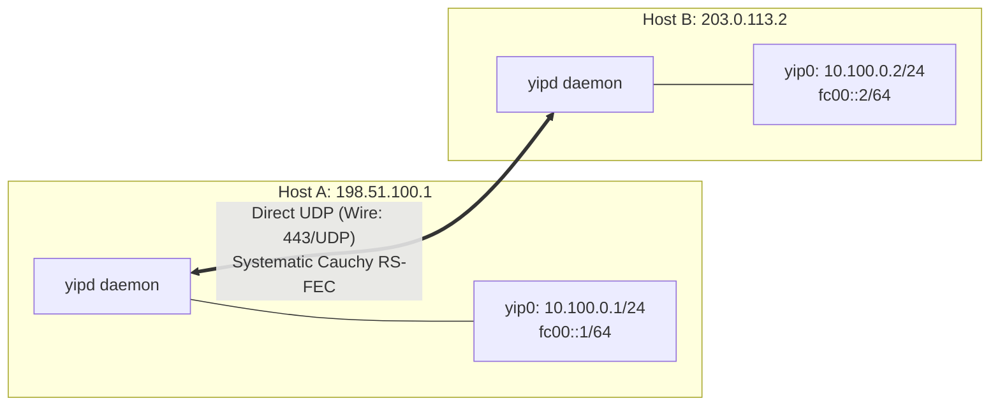
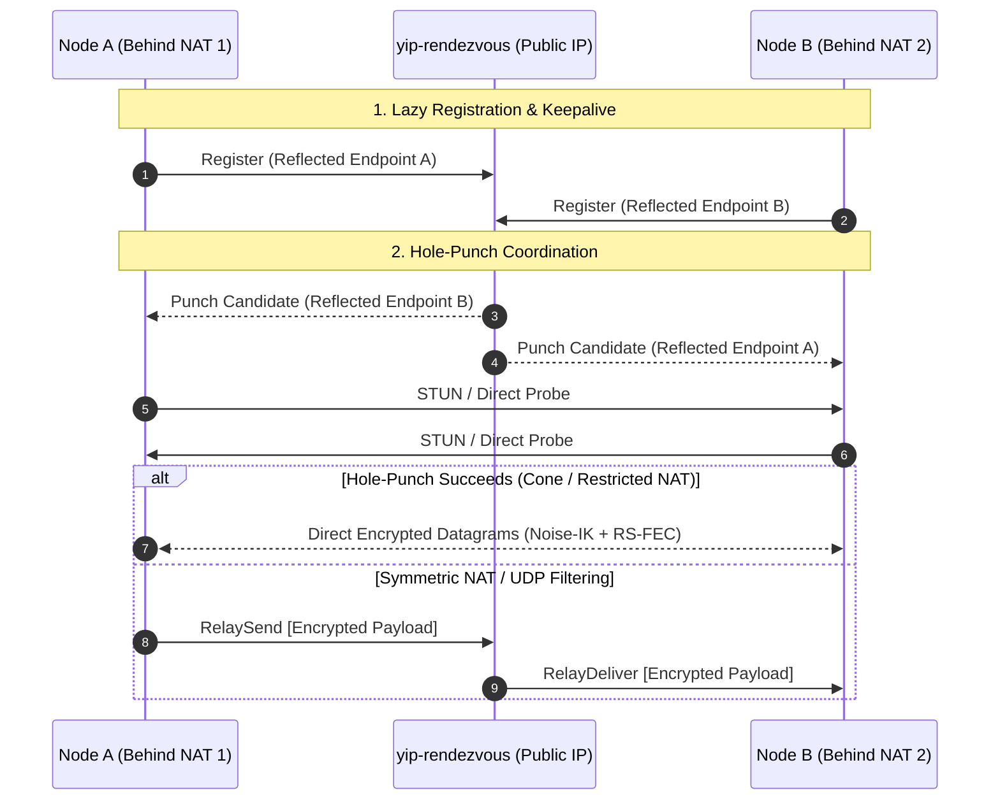
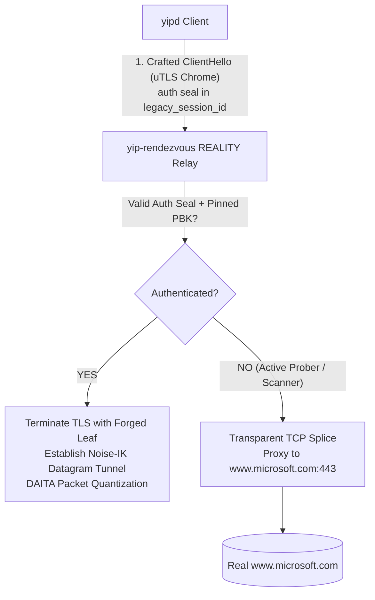
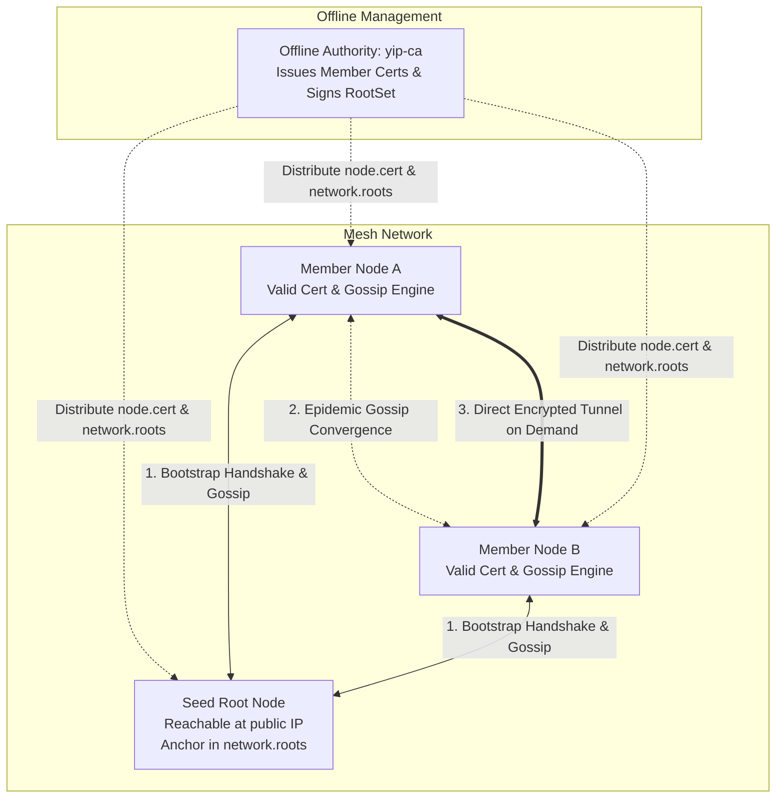

# Configuration Reference & Topology Catalog

This document is the definitive configuration guide and topology catalog for `yip` and its core daemon, `yipd`. It covers end-to-end deployment topologies, complete annotated parameter specifications verified against [`bin/yipd/src/config.rs`](../bin/yipd/src/config.rs), validation procedures, and runtime socket management.

For initial installation and system service setup, see [01-getting-started.md](01-getting-started.md).
For wire protocol internals and cryptography specifications, see [architecture.md](architecture.md).
For automated benchmarks and performance tuning, see [testing-and-benchmarking.md](testing-and-benchmarking.md).
A baseline commented configuration file is maintained at [`example.config`](../example.config).

---

## Table of Contents

- [1. Configuration Architecture](#1-configuration-architecture)
  - [Syntax and Grammar](#syntax-and-grammar)
  - [Key-Value Directive Mapping](#key-value-directive-mapping)
  - [File Security and Linux Capabilities](#file-security-and-linux-capabilities)
- [2. Starter Topology Catalog](#2-starter-topology-catalog)
  - [Scenario A: Static Direct Point-to-Point (VPS-to-VPS)](#scenario-a-static-direct-point-to-point-vps-to-vps)
  - [Scenario B: Dynamic NAT Traversal (STUN & Blind Relay)](#scenario-b-dynamic-nat-traversal-stun--blind-relay)
  - [Scenario C: Censorship-Circumvention Transport (REALITY + uTLS + DAITA)](#scenario-c-censorship-circumvention-transport-reality--utls--daita)
  - [Scenario D: Multi-Queue AF_XDP Enterprise Gateway (10G/40G/100G)](#scenario-d-multi-queue-af_xdp-enterprise-gateway-10g40g100g)
- [3. Annotated Parameter Reference Dictionary](#3-annotated-parameter-reference-dictionary)
  - [Node & Control (`[node]`)](#node--control-node)
  - [Interface & Kernel Driver (`[interface]`)](#interface--kernel-driver-interface)
  - [Wire Transport (`[transport]`)](#wire-transport-transport)
  - [Forward Error Correction (`[fec]`)](#forward-error-correction-fec)
  - [Anti-DPI Obfuscation & Traffic Defense (`[obfuscation]`)](#anti-dpi-obfuscation--traffic-defense-obfuscation)
  - [Rendezvous, Relays & Mesh Discovery (`[rendezvous]`)](#rendezvous-relays--mesh-discovery-rendezvous)
  - [Peer Declarations (`[peer]`)](#peer-declarations-peer)
- [4. Configuration Validation & Hot-Reloading](#4-configuration-validation--hot-reloading)
  - [Configuration Validation & Safety Checks](#configuration-validation--safety-checks)
  - [Mutual Exclusivity & Conflict Matrix](#mutual-exclusivity--conflict-matrix)
  - [Dynamic Reloading via SIGHUP](#dynamic-reloading-via-sighup)
  - [Runtime Socket Management (`yipctl`)](#runtime-socket-management-yipctl)
- [5. Troubleshooting Common Failures](#5-troubleshooting-common-failures)

---

## 1. Configuration Architecture

### Syntax and Grammar

`yipd` reads configuration from a line-based `key=value` text file. The configuration parser conforms to the following rules:

1. **One directive per line**: Each active configuration statement must be formatted as `key=value`. Whitespace surrounding keys and values is stripped automatically.
2. **Comments and blanks**: Blank lines and lines beginning with `#` are treated as comments and ignored. Inline comments following values are not supported on standard key assignments.
3. **Hexadecimal formatting**: All cryptographic keys, hashes, and identifiers are formatted as raw hexadecimal strings (lowercase or uppercase):
   - **64 hex characters (32 bytes)**: X25519 node keys, peer public keys, Ed25519 CA keys, Ed25519 member signing keys, obfuscation PSKs, and REALITY public keys.
   - **32 hex characters (16 bytes)**: Mesh `network_id`.
   - **16 hex characters (8 bytes)**: REALITY `short_id` tokens.
4. **Peer blocks**: Multiple remote peers are defined using repeatable `[peer]` block headers, followed by peer-scoped `public_key` and optional `endpoint` directives.
5. **Forward compatibility**: Unrecognized configuration keys are silently ignored, permitting older or newer daemon releases to share configuration files without failing.

### Key-Value Directive Mapping

`yip` is migrating toward a fully structured TOML schema. Today, `bin/yipd/src/config.rs` parses the unified key-value format while logically segmenting parameters into functional domains:

```
[node]          -> local_private, local_public, listen, control_socket
[interface]     -> device, device_kind, mtu, shards
[transport]     -> transport, tls_sni
[fec]           -> systematic Cauchy RS-FEC / P+Q engine parameters
[obfuscation]   -> obf_psk, traffic_defense, defense_buckets, defense_cover_*
[rendezvous]    -> rendezvous, ca_public, cert, roots, member_sign_private, network_id
[peer]          -> public_key, endpoint (repeatable blocks)
```

In the parameter dictionary below, both the canonical section structure and the exact wire key names accepted by [`bin/yipd/src/config.rs`](../bin/yipd/src/config.rs) are provided.

### File Security and Linux Capabilities

Configuration files contain long-term private keys (`local_private`, `member_sign_private`) and pre-shared obfuscation secrets (`obf_psk`). Protect the configuration file with strict filesystem access controls:

```sh
sudo chown root:root /etc/yip/yipd.conf
sudo chmod 0600 /etc/yip/yipd.conf
```

`yipd` does not require full root privileges if granted ambient Linux capabilities:
- `CAP_NET_ADMIN`: Allocate and configure TUN/TAP devices and interface IP addresses.
- `CAP_NET_RAW`: Construct and bind low-level sockets.
- `CAP_NET_BIND_SERVICE`: Bind privileged low-number ports (e.g. `443/UDP` or `443/TCP`).
- `CAP_IPC_LOCK`: Lock UMEM pages for io_uring and AF_XDP kernel-bypass rings (`ulimit -l unlimited`).

---

## 2. Starter Topology Catalog

### Scenario A: Static Direct Point-to-Point (VPS-to-VPS)

This scenario connects two publicly addressable Linux cloud instances over a direct UDP tunnel with symmetric Cauchy Reed-Solomon Forward Error Correction (RS-FEC). Both endpoints have static public IPv4/IPv6 addresses.



#### Host A Configuration (`/etc/yip/yipd.conf`)

```ini
# Core node parameters
local_private=e81d76326087b220d3f237ef39aa4d91361ff55b7661005a7657d23d8c117d4a
local_public=7df4d68205f03a2cae7e1713444fcda80ff43a29de7e9b0b4b2c159286d9a11a
listen=0.0.0.0:443
device=yip0
device_kind=tun
mtu=1400
shards=1
control_socket=/run/yipd/yip.sock

# Wire transport
transport=raw

# Remote peer declaration: Host B
[peer]
public_key=9b49ffeb4566b53a0f78cae08920bc9e30a6e0c60f252cfdf4740e74f8c92b21
endpoint=203.0.113.2:443
```

#### Host B Configuration (`/etc/yip/yipd.conf`)

```ini
# Core node parameters
local_private=50b522bb0b57e7eb133e9b11b5275ea011cf8c3f4e24eb37452d192131b0e01c
local_public=9b49ffeb4566b53a0f78cae08920bc9e30a6e0c60f252cfdf4740e74f8c92b21
listen=0.0.0.0:443
device=yip0
device_kind=tun
mtu=1400
shards=1
control_socket=/run/yipd/yip.sock

# Wire transport
transport=raw

# Remote peer declaration: Host A
[peer]
public_key=7df4d68205f03a2cae7e1713444fcda80ff43a29de7e9b0b4b2c159286d9a11a
endpoint=198.51.100.1:443
```

#### Network Interface Bring-Up & Verification

Once `yipd` is launched on both hosts, assign overlay addresses to the virtual interfaces:

**On Host A:**
```sh
sudo ip link set yip0 up
sudo ip addr add 10.100.0.1/24 dev yip0
sudo ip addr add fc00::1/64 dev yip0
```

**On Host B:**
```sh
sudo ip link set yip0 up
sudo ip addr add 10.100.0.2/24 dev yip0
sudo ip addr add fc00::2/64 dev yip0
```

**Verify connectivity:**
```sh
ping -c 4 10.100.0.2
yipctl top
```

> [!NOTE]
> `listen=0.0.0.0:443` binds UDP port 443. Port 443 is unassigned to traditional VPN protocols and avoids automated DPI port filters that match WireGuard (51820) or OpenVPN (1194).

---

### Scenario B: Dynamic NAT Traversal (STUN & Blind Relay)

This scenario connects two nodes residing behind residential or carrier-grade NAT (CGNAT) without public IP addresses. Both nodes coordinate through an intermediate, unprivileged `yip-rendezvous` server.



#### Rendezvous Server Deployment

On a publicly accessible cloud instance (e.g. `198.51.100.5`):

```sh
# Run unprivileged standalone rendezvous with shared obfuscation PSK
yip-rendezvous 0.0.0.0:51821 \
  --obf-psk c058438031ac60191a28852334d20f33ef7ad15ac39ede42150bd23d66f5b024
```

#### Node A Configuration (`/etc/yip/yipd.conf`)

```ini
local_private=dd152fc311a115549005da852d101a7d3a14594c728f71ff87aa0872da6c0fa9
local_public=bf923deeaddb66dde39e99987abdfd789c54eb882a570c340cd338071727ceeb
listen=0.0.0.0
device=yip0
device_kind=tun

# Intermediate rendezvous coordinator
rendezvous=198.51.100.5:51821
obf_psk=c058438031ac60191a28852334d20f33ef7ad15ac39ede42150bd23d66f5b024

# Remote peer: endpoint is omitted because Node B is behind NAT
[peer]
public_key=1f5b6b76d9723a79221777a7450522c32faa7300efd59b0a5efa42665cac0a0a
```

#### Node B Configuration (`/etc/yip/yipd.conf`)

```ini
local_private=b7f496a24be70c3a856e53a21456963c784aaf0d4f21dce9eca620120974eada
local_public=1f5b6b76d9723a79221777a7450522c32faa7300efd59b0a5efa42665cac0a0a
listen=0.0.0.0
device=yip0
device_kind=tun

# Intermediate rendezvous coordinator
rendezvous=198.51.100.5:51821
obf_psk=c058438031ac60191a28852334d20f33ef7ad15ac39ede42150bd23d66f5b024

# Remote peer: endpoint is omitted because Node A is behind NAT
[peer]
public_key=bf923deeaddb66dde39e99987abdfd789c54eb882a570c340cd338071727ceeb
```

> [!TIP]
> **Escalation Path**: Nodes begin in the `Direct` probe state. If direct packets are not acknowledged, they transition to `Punch` (coordinated bidirectional UDP hole punching). If symmetric NAT mapping is detected, traffic transparently fails over to `Relay` blind forwarding. The rendezvous server only sees ciphertext and cannot inspect inner tunnel contents.

---

### Scenario C: Censorship-Circumvention Transport (REALITY + uTLS + DAITA)

This scenario is designed for highly hostile network environments subject to active probing, machine learning traffic classification, and stateful Deep Packet Inspection (DPI).

It deploys:
1. **uTLS Chrome Impersonation**: Outbound TLS `ClientHello` messages mimic Google Chrome byte-for-byte.
2. **Xray-REALITY TLS 1.3 Certificate Borrowing**: The server steals a live TLS 1.3 leaf certificate from a high-reputation domain (e.g. `www.microsoft.com`). Unauthenticated active probers are transparently spliced into the real target site.
3. **DAITA Traffic Analysis Defenses**: Quantizes packet sizes into fixed buckets and injects stochastic decoy cover bursts during idle periods.



#### Relay Server Launch Command

On a public VPS outside censorship boundaries:

```sh
yip-rendezvous 0.0.0.0:51821 \
  --obf-psk 6d752f062201ce61222b06e28317c4568f0f3501d0eb4a5e28c0ac0b541f8f18 \
  --listen-tcp 0.0.0.0:443 \
  --reality-dest www.microsoft.com:443 \
  --reality-server-name www.microsoft.com \
  --reality-private-key a588ac85b395f7403c042e72fa4891ade68dda1779e7356a9823116bb098f527 \
  --reality-short-id 0123456789abcdef
```

*Note: The corresponding public key for private key `a588ac85...f527` is derived via `yipd --genkey` or `yip-rendezvous` key utility (e.g. `9246fe11...9366`).*

#### Client Node Configuration (`/etc/yip/yipd.conf`)

```ini
local_private=d8e1d3269e750a802a3a64c9f07c2691ebbbc830a00d7a2f98aac554708822ab
local_public=5bc3510da3fb0d32c493aab3a1eac641f81a7f87cc7d3977af594174e4d3c946
listen=0.0.0.0
device=yip0
device_kind=tun

# REALITY Relay Dial
# Syntax: reality://<relay-host>:<port>?pbk=<pubkey>&sid=<short-id>&sni=<decoy-sni>&verify=on
rendezvous=reality://relay.example.org:443?pbk=9246fe11d923f5cc24424c1833fba7aec0f80868987b2c3fa77e6543dec69366&sid=0123456789abcdef&sni=www.microsoft.com&verify=on
obf_psk=6d752f062201ce61222b06e28317c4568f0f3501d0eb4a5e28c0ac0b541f8f18

# Traffic Analysis Defense (DAITA)
traffic_defense=paranoid
defense_buckets=512,1420
defense_cover_interval_ms=150
defense_cover_burst_max=4
defense_jitter_max_ms=4

# Far-end peer terminating through the same REALITY relay
[peer]
public_key=93dedf18e5942c787403576ab4fc80e8969a760912613957781c930ae0ddbb61
```

> [!IMPORTANT]
> **Relay Verification (`verify=on`)**: The client cryptographically verifies that the server's ephemeral TLS 1.3 `CertificateVerify` signature is derived from the shared ECDH auth secret. If an on-path censor intercepts or proxies the connection, verification fails closed, emitting a browser-faithful `bad_certificate` alert before backing off.

---

### Scenario D: Multi-Queue AF_XDP Enterprise Gateway (10G/40G/100G)

This scenario configures a high-throughput enterprise edge gateway serving hundreds of concurrent tunnels across a multi-core server with hardware RSS packet steering and multi-queue TUN allocations.

```mermaid
flowchart TD
    subgraph NIC [Hardware NIC (10G/40G/100G)]
        Q0[RX/TX Queue 0]
        Q1[RX/TX Queue 1]
        Q2[RX/TX Queue 2]
        Q3[RX/TX Queue 3]
    end

    subgraph Datapath [yipd Multi-Queue Worker Shards]
        W0[Worker Shard 0<br/>CPU Core 0 / io_uring]
        W1[Worker Shard 1<br/>CPU Core 1 / io_uring]
        W2[Worker Shard 2<br/>CPU Core 2 / io_uring]
        W3[Worker Shard 3<br/>CPU Core 3 / io_uring]
    end

    subgraph TUN [Multi-Queue TUN Device (IFF_MULTI_QUEUE)]
        T0[Queue Handle 0]
        T1[Queue Handle 1]
        T2[Queue Handle 2]
        T3[Queue Handle 3]
    end

    Q0 <--> W0 <--> T0
    Q1 <--> W1 <--> T1
    Q2 <--> W2 <--> T2
    Q3 <--> W3 <--> T3
```

#### Gateway Host Configuration (`/etc/yip/yipd.conf`)

```ini
# Core Node
local_private=38e55e4bf5b7d903f5ad6f406ab2d3e0984a95610ecae251783515436c7a8fe8
local_public=47d25e016147610fa65d93e157291a13481e18d6e326b48fbba2637651a5d2eb
listen=198.51.100.10:443
device=yip0
device_kind=tun

# Enterprise Datapath Scaling
mtu=9000
shards=8
control_socket=/run/yipd/yip.sock
transport=raw

# Remote Datacenter Peer
[peer]
public_key=4138e653ea9d05e0455dbca11bda603b54d6fa7c588523ae1c5eec7d121c272f
endpoint=203.0.113.50:443

# Remote Branch Office Peer
[peer]
public_key=19b48f95c0c920f3c8340d99ef871ef3b55a8e0cb2049e6f3dfaa6221f00b991
endpoint=198.51.100.200:443
```

#### Kernel & System Optimization Directives

Before launching the enterprise gateway, tune Linux socket buffers and locked memory limits:

```sh
# 1. Allow locked memory allocation for AF_XDP / io_uring UMEM rings
sudo prlimit --pid=$$ --memlock=unlimited

# 2. Configure network socket buffer maximums
sudo sysctl -w net.core.rmem_max=134217728
sudo sysctl -w net.core.wmem_max=134217728
sudo sysctl -w net.core.netdev_max_backlog=250000

# 3. Match physical NIC RSS queues to worker shards (e.g. 8 cores)
sudo ethtool -L eth0 combined 8

# 4. Launch daemon with io_uring busy-polling enabled
export YIP_USE_URING=1
export YIP_URING_BUSYPOLL=1
sudo -E yipd /etc/yip/yipd.conf
```

> [!NOTE]
> Setting `shards=8` enables multi-threaded core pinning. `yipd` allocates an `IFF_MULTI_QUEUE` TUN interface with 8 file descriptors and creates 8 `SO_REUSEPORT` UDP listening sockets, ensuring that packet processing never suffers cross-core mutex contention.

---

### Scenario E: Decentralized Zero-Trust Mesh (`yip-ca` + Gossip Discovery)

This scenario deploys an enterprise or community zero-trust mesh where nodes authenticate through an offline Certificate Authority (`yip-ca`), gossip peer reachability dynamically, and require **zero manual `[peer]` blocks**.



#### 1. Issue Member Certificates via `yip-ca`

On your offline administrative workstation:

```sh
# Mint the root CA
yip-ca genkey > ca.key

# Issue cert for Member Node A (using Node A's identity and signing public keys)
yip-ca sign-cert \
  --member 4cbc48cf095389d829abf3c7d78747ca35c96483375bd73860b2ebba94c99d50 \
  --member-sign c0b221a5986e7d279d9c39040a1db1721ee57f5febb2f6be4a661aa1076e9e8a \
  --network f11a8e0df8fa6352eeb62192de7ece47 \
  --days 365 \
  --ca-private $(grep '^ca_private=' ca.key | cut -d= -f2) > nodeA.cert

# Assemble and sign the seed root set (listing Seed Node)
echo "bf923deeaddb66dde39e99987abdfd789c54eb882a570c340cd338071727ceeb 198.51.100.1:443" > roots.in
yip-ca sign-roots \
  --roots roots.in \
  --version 1 \
  --ca-private $(grep '^ca_private=' ca.key | cut -d= -f2) > network.roots
```

#### 2. Seed Node Configuration (`/etc/yip/yipd.conf` on 198.51.100.1)

```ini
local_private=dd152fc311a115549005da852d101a7d3a14594c728f71ff87aa0872da6c0fa9
local_public=bf923deeaddb66dde39e99987abdfd789c54eb882a570c340cd338071727ceeb
listen=0.0.0.0:443
device=yip0
device_kind=tun

# All 5 Mesh Directives
ca_public=8a03a4cf43c2907041efb394c0effabad5bdb4cbbc35d17c924c0b6cbfa8ba75
cert=/etc/yip/seed.cert
roots=/etc/yip/network.roots
member_sign_private=986590d0751560e38dff71028e032c0182c6de4c327b06eda5e0a476efd13eba
network_id=f11a8e0df8fa6352eeb62192de7ece47
```

#### 3. Member Node Configuration (`/etc/yip/yipd.conf` on Node A)

```ini
local_private=2f2b5880cc15f29f826e876f5396c6f418e2366b73b415c5441f152b23c0334d
local_public=4cbc48cf095389d829abf3c7d78747ca35c96483375bd73860b2ebba94c99d50
listen=0.0.0.0:443
device=yip0
device_kind=tun

# All 5 Mesh Directives
ca_public=8a03a4cf43c2907041efb394c0effabad5bdb4cbbc35d17c924c0b6cbfa8ba75
cert=/etc/yip/nodeA.cert
roots=/etc/yip/network.roots
member_sign_private=c22239d00522843313aa03a662e8f0cb6abb7889f8f103510ebb5dee0e924857
network_id=f11a8e0df8fa6352eeb62192de7ece47

# Optional: Set rendezvous relay for members behind NAT
rendezvous=198.51.100.1:443
```

---

## 3. Annotated Parameter Reference Dictionary

### Node & Control (`[node]`)

Parameters governing node identity, cryptographic keys, network listening, and administration sockets.

| Configuration Directive | Type | Default Value | Valid Range / Format | Operational Impact |
| :--- | :--- | :--- | :--- | :--- |
| `local_private`<br/>*(TOML: `node_key`)* | String (Hex) | *None* (Required) | 64 hex characters (32 bytes) | Defines this node's long-term X25519 private key. Kept strictly secret. Used to authenticate handshakes via Noise-IK. |
| `local_public` | String (Hex) | *None* (Required) | 64 hex characters (32 bytes) | Public half of the node's X25519 keypair. Determines the node's self-certifying IPv6 address (`yipd --addr`). |
| `listen`<br/>*(TOML: `listen_port`)* | String | `0.0.0.0:443` | `IP:port` or `IP` | Local socket bind address. If port is omitted or absent, defaults to port 443 with fallback to 8443 if unprivileged. |
| `control_socket` | String (Path) | `/run/yipd/yip.sock` | Absolute filesystem path | Path to UNIX domain control socket for `yipctl` command-and-control and live telemetry. |
| `log_level` | String | `info` | `trace`, `debug`, `info`, `warn`, `error` | Output verbosity emitted to stderr and systemd journal. |

#### Port Plausibility & Fallback Rules
`yipd` avoids identifiable default VPN ports (such as `51820` for WireGuard, `1194` for OpenVPN, and `500`/`4500` for IPsec). When `listen` is omitted or provided as an IP without a port (e.g. `listen=0.0.0.0`), port **443** is auto-selected. If binding 443 fails with `EACCES` / `PermissionDenied` (e.g. unprivileged execution without `CAP_NET_BIND_SERVICE`), `yipd` falls back to port **8443** and logs a warning.

---

### Interface & Kernel Driver (`[interface]`)

Parameters governing the virtual Linux network adapter and kernel packet datapath.

| Configuration Directive | Type | Default Value | Valid Range / Format | Operational Impact |
| :--- | :--- | :--- | :--- | :--- |
| `device`<br/>*(TOML: `name`)* | String | *None* (Required) | String (e.g. `yip0`, `tun1`) | Virtual network adapter name registered with the Linux network stack. |
| `device_kind` | String | `tun` | `tun`, `tap` | Selects datapath encapsulation mode: `tun` creates an L3 (IP) tunnel; `tap` creates an L2 (Ethernet frame) tunnel for bridging. |
| `overlay_ip` | String (CIDR) | *Self-derived* | IPv4 or IPv6 CIDR address | Overlay IP address assigned to the tunnel interface. Can be configured manually or derived via `yipd --addr`. |
| `mtu` | Integer | `1400` | `576` to `65535` | Maximum Transmission Unit. Set to `1400` for standard WAN paths to accommodate UDP/IP/crypto overhead. Set up to `9000` for jumbo-frame LANs. |
| `shards`<br/>*(Alias: `threads`)* | Integer | `1` | `1` to `N` (CPU core count) | Number of worker execution threads. Values > 1 allocate `IFF_MULTI_QUEUE` descriptors and pin workers to discrete physical cores. |
| `driver` | String (Env) | `epoll` | `epoll`, `io_uring`, `af_xdp` | Datapath socket engine. Configured via runtime environment variables (`YIP_USE_URING=1`, `YIP_URING_BUSYPOLL=1`). |

---

### Wire Transport (`[transport]`)

Parameters governing the external wire encapsulation and mimicry costume.

| Configuration Directive | Type | Default Value | Valid Range / Format | Operational Impact |
| :--- | :--- | :--- | :--- | :--- |
| `transport`<br/>*(TOML: `kind`)* | String | `raw` | `raw`, `udp`, `quic`, `tls` | Wire encapsulation mode: `raw` runs directly over UDP; `quic` mimics QUIC / HTTP-3 (RFC 9221); `tls` runs TLS 1.3 over TCP/443. |
| `tls_sni` | String | `www.apple.com` | Fully Qualified Domain Name | Server Name Indication presented in the outer TLS `ClientHello` when `transport=tls`. |
| `flow_class` | String | `default` | `interactive`, `bulk`, `default` | Classifies traffic for scheduling and FEC redundancy. `interactive` enforces low latency; `bulk` optimizes throughput. |
| `daita_padding` | Boolean | `false` | `true`, `false` | Enables deterministic packet length quantization. Activated automatically via `traffic_defense`. |

> [!WARNING]
> `transport=quic` and `transport=tls` provide their own transport-layer obfuscation and are **mutually exclusive** with `obf_psk` and `traffic_defense`.

---

### Forward Error Correction (`[fec]`)

Parameters governing userspace Galois Field $GF(2^8)$ Cauchy Reed-Solomon erasure coding and loss recovery.

> [!TIP] Clever Fox Tip: Dynamic Loss Adaptation
> yip doesn't just blast redundant packets blindly. Its Cauchy Reed-Solomon engine continuously gauges link turbulence: on clean links, repair overhead stays at a feather-light 10%, but when packets start disappearing into the void, yip automatically boosts parity output up to 50% to reconstruct your packets without breaking stride.

> [!NOTE]
> The Cauchy Reed-Solomon FEC engine (`crates/yip-transport/src/fec.rs`) is built into the `yip` transport layer and automatically generates proactive repair symbols adaptively based on real-time link loss. The parameters below document default internal values and planned configuration overrides.

| Configuration Directive | Type | Default Value | Valid Range / Format | Operational Impact |
| :--- | :--- | :--- | :--- | :--- |
| `enabled` | Boolean | `true` | `true`, `false` | Toggles userspace FEC erasure coding. When disabled, packets rely exclusively on link-layer retransmissions. |
| `scheme` | String | `cauchy` | `cauchy`, `pq` | FEC generator matrix scheme. `cauchy` provides optimal MDS recovery for arbitrary $K+M$ symbol ratios; `pq` provides SIMD dual-parity XOR fast-paths. |
| `initial_repair_ratio` | Float | `0.10` (10%) | `0.0` to `1.0` | Baseline ratio of redundant repair symbols generated per block of source datagrams. |
| `max_repair_ratio` | Float | `0.50` (50%) | `0.0` to `2.0` | Maximum adaptive FEC repair symbol overhead dynamically allocated under extreme packet loss. |
| `target_loss_fraction` | Float | `0.01` (1%) | `0.00` to `0.20` | Dynamic loss threshold that triggers automatic upward scaling of the FEC repair ratio. |
| `arq_timeout_ms` | Integer | `30` | `5` to `500` ms | Selective retransmission timeout before unrecoverable erasure blocks request retransmission. |

---

### Anti-DPI Obfuscation & Traffic Defense (`[obfuscation]`)

Parameters governing wire masking, DAITA packet-size bucketing, decoy cover traffic, and REALITY probing defenses.

| Configuration Directive | Type | Default Value | Valid Range / Format | Operational Impact |
| :--- | :--- | :--- | :--- | :--- |
| `obf_psk`<br/>*(TOML: `psk`)* | String (Hex) | *None* (Optional) | 64 hex characters (32 bytes) | Network-wide shared secret. Transforms wire datagrams into uniform pseudorandom noise with no static headers or magic bytes. |
| `traffic_defense` | String | `off` | `off`, `balanced`, `paranoid` | DAITA defense preset against statistical packet-size and timing analysis attacks. |
| `defense_buckets` | String | *Preset default* | Comma-separated integers (`64`..`1500`) | Explicit packet byte size quantization targets (must be strictly ascending). Outbound datagrams are padded up to the nearest bucket. |
| `defense_cover_interval_ms` | Integer | *Preset default* | Integer > 0 (Milliseconds) | Cadence between stochastic cover traffic bursts emitted during idle periods. |
| `defense_cover_burst_max` | Integer | *Preset default* | `1` to `8` | Maximum number of dummy decoy datagrams (`ptype == JUNK_TYPE`) transmitted in a single cover burst. |
| `defense_jitter_max_ms` | Integer | *Preset default* | `0` to `10` (Milliseconds) | Maximum bounded random egress delay injected into the packet scheduling queue to disrupt inter-arrival timing signatures. |
| `reality_sni` | String | *None* | Domain Name | Borrowed SNI host presented in the REALITY `ClientHello` handshake. |
| `reality_public_key`<br/>*(Param: `pbk`)* | String (Hex) | *None* | 64 hex characters (32 bytes) | Public X25519 key of the remote REALITY relay server. |

#### DAITA Preset Reference Table

| Preset | Default Buckets | Cover Interval | Burst Max | Max Jitter | Operational Profile |
| :--- | :--- | :--- | :--- | :--- | :--- |
| `off` | *(No padding)* | *None* | 1 | 0 ms | Raw throughput; zero bandwidth overhead. |
| `balanced` | `256, 512, 1024, 1420` | 500 ms | 2 | 2 ms | Moderate padding and low-frequency decoys; recommended for general circumvention. |
| `paranoid` | `512, 1420` | 150 ms | 4 | 4 ms | Aggressive padding to jumbo MTUs, frequent cover bursts; defeats stateful machine-learning classifiers. |

---

### Rendezvous, Relays & Mesh Discovery (`[rendezvous]`)

Parameters governing NAT traversal, blind relays, and decentralized cryptographic membership mesh operation.

| Configuration Directive | Type | Default Value | Valid Range / Format | Operational Impact |
| :--- | :--- | :--- | :--- | :--- |
| `rendezvous`<br/>*(TOML: `server`)* | String | *None* (Optional) | `IP:port`, `tls://...`, `reality://...` | Coordinator address. Supports plain UDP (`IP:port`), TLS relay (`tls://host:port`), and REALITY relay dial (`reality://...`). |
| `ca_public` | String (Hex) | *None* (Repeatable) | 64 hex characters (32 bytes) | Trusted root CA Ed25519 public key(s). Used to verify membership certificates and the network root set. |
| `cert` | String (Path) | *None* | Filesystem path | Path to file containing this node's CA-signed membership certificate blob. |
| `roots` | String (Path) | *None* | Filesystem path | Path to file containing the CA-signed root set. Verified against `ca_public` at boot. |
| `member_sign_private` | String (Hex) | *None* | 64 hex characters (32 bytes) | Node Ed25519 signing key used to sign gossip membership records. Kept strictly secret. |
| `network_id` | String (Hex) | *None* | 32 hex characters (16 bytes) | Unique 16-byte identifier for the private mesh network. |

#### Rendezvous Dial Scheme Formats
- **Plain UDP**: `rendezvous=198.51.100.5:51821`
- **TLS Relay Dial**: `rendezvous=tls://relay.example.com:443` *(Requires `obf_psk`)*
- **REALITY Relay Dial**: `rendezvous=reality://relay.example.com:443?pbk=<hex64>&sid=<hex16>&sni=<domain>&verify=<on|off>` *(Requires `obf_psk`)*

---

### Peer Declarations (`[peer]`)

Parameters defined within repeatable `[peer]` blocks to establish connections to remote participants.

| Configuration Directive | Type | Default Value | Valid Range / Format | Operational Impact |
| :--- | :--- | :--- | :--- | :--- |
| `public_key` | String (Hex) | *None* (Required) | 64 hex characters (32 bytes) | Remote peer's public X25519 key. Authenticates the peer during Noise-IK key exchange. |
| `endpoint` | String | *None* (Optional) | `IP:port` (IPv4 or `[IPv6]:port`) | Direct UDP endpoint. If omitted, the peer is reached via rendezvous STUN hole punching or blind relaying. |

> [!IMPORTANT]
> **Cryptographic Addressing vs. WireGuard `allowed_ips`**:
> Unlike WireGuard, `yip` does **not** parse or rely on `allowed_ips` prefix filtering for access control. In `yip`, peer overlay addresses in `fd00::/8` are **cryptographically derived** from the peer's public key (via `BLAKE2s-120`). Inbound packets are authenticated against the sender's authenticated cryptographic session key; address spoofing and squatting are mathematically prevented at the crypto layer. Direct route configuration is handled via the operating system network stack (`ip -6 route`). Advanced per-peer overrides (`fec_ratio_override`, custom `keepalive_secs`) are planned extensions; link maintenance and adaptive FEC recovery are handled automatically by `yip`'s transport engine.

---

## 4. Configuration Validation & Hot-Reloading

### Configuration Validation & Safety Checks

`yipd` validates configuration grammar, key lengths, MTU boundaries, and semantic invariants immediately upon load via `Config::parse()`:

```sh
# Start daemon with configuration file (validates semantics before bringing up interfaces)
sudo yipd /etc/yip/yipd.conf
```

`yipd` executes the following fail-fast validations on startup before creating virtual interfaces or allocating worker threads:
1. **Hex character length tests**: Confirms all keys are exact-length hex (64 chars for 32-byte keys, 32 chars for 16-byte network IDs, 16 chars for 8-byte short IDs).
2. **MTU boundaries**: Verifies `mtu` falls within `576..=65535`.
3. **Bucket monotonic ordering**: Ensures `defense_buckets` contains strictly ascending values between 64 and 1500 bytes.
4. **Root signature verification**: In mesh mode, verifies that `roots` is cryptographically signed by an anchor present in `ca_public`.
5. **Port conflict & plausibility**: Emits warnings if a listen address collides with fingerprinted VPN ports (51820, 1194, 500, etc.), falling back to 8443 if unprivileged.

### Mutual Exclusivity & Conflict Matrix

The configuration loader enforces strict compile-time and run-time invariants:

```mermaid
graph TD
    A[transport = quic | tls] -->|FORBIDS| B[obf_psk]
    A -->|FORBIDS| C[traffic_defense]
    D[traffic_defense = balanced | paranoid] -->|REQUIRES| B
    E[rendezvous = tls:// | reality://] -->|REQUIRES| B
    E -->|FORCES| F[driver = epoll]
    G[Mesh Mode] -->|REQUIRES ALL 5| H[ca_public + cert + roots + member_sign_private + network_id]
```

- `transport=quic` or `transport=tls` **cannot** be combined with `obf_psk` or `traffic_defense` (double-wrapping is rejected).
- `traffic_defense` **requires** `obf_psk` (decoy traffic must be indistinguishable from ciphertext).
- `rendezvous=tls://` or `rendezvous=reality://` **requires** `obf_psk` (acts as the relay registration discriminator).
- Mesh mode requires **all five** mesh directives (`ca_public`, `cert`, `roots`, `member_sign_private`, `network_id`).

### Dynamic Reloading via SIGHUP

`yipd` supports dynamic reconfiguration without terminating active sessions. Sending a `SIGHUP` signal instructs the daemon to reload `/etc/yip/yipd.conf`:

```sh
sudo kill -HUP $(pgrep yipd)
```

**Hot-Reloadable Parameters:**
- Dynamic additions, removals, and endpoint modifications in `[peer]` blocks.
- DAITA parameters (`defense_buckets`, `defense_cover_interval_ms`, `defense_jitter_max_ms`).
- Logging levels (`log_level`).

**Immutable Parameters (Require Daemon Restart):**
- Primary TUN device name (`device`) and encapsulation mode (`device_kind`).
- Worker shard count (`shards`).
- Local listening socket (`listen`).

### Runtime Socket Management (`yipctl`)

For headless systems and orchestrators, `yipd` exposes an IPC server over its UNIX domain control socket (`control_socket=/run/yipd/yip.sock`). The companion CLI `yipctl` communicates with the running daemon:

```sh
# Query daemon status and uptime
yipctl status

# Output status in machine-readable JSON
yipctl status --json

# List active peers, endpoints, loss recovery, and RTT
yipctl peers

# Dynamically add a new peer at runtime
yipctl peer add <PUBLIC_KEY_HEX> 203.0.113.25:443 raw

# Dynamically remove a peer
yipctl peer rm <PUBLIC_KEY_HEX>

# Launch the real-time terminal throughput dashboard
yipctl top
```

---

## 5. Troubleshooting Common Failures

### 1. `PermissionDenied` when binding port 443
- **Cause**: Unprivileged process attempting to bind a network port below 1024.
- **Remediation**: Grant `CAP_NET_BIND_SERVICE` or allow `yipd` to automatically fall back to port 8443:
  ```sh
  sudo setcap cap_net_bind_service+ep /usr/local/bin/yipd
  ```

### 2. `traffic_defense requires obf_psk`
- **Cause**: DAITA packet quantization or cover traffic was enabled without defining an obfuscation pre-shared key.
- **Remediation**: Add `obf_psk=<64-hex-chars>` to `/etc/yip/yipd.conf`.

### 3. `defense_buckets must be strictly ascending`
- **Cause**: Bucket sizes are out of order (e.g. `1024,512,1420`).
- **Remediation**: Sort the buckets in numerical order: `defense_buckets=512,1024,1420`.

### 4. `root set signature does not verify against any configured ca_public`
- **Cause**: The root set file (`roots=...`) was modified, corrupted, or signed with a CA key not present in `ca_public`.
- **Remediation**: Re-sign the root set using `yip-ca sign-roots` with the authoritative CA private key.

### 5. `transport=quic is mutually exclusive with obf_psk`
- **Cause**: Both a mimicry transport and raw datagram obfuscation were specified simultaneously.
- **Remediation**: Remove `obf_psk` when using `transport=quic` or `transport=tls`, or revert to `transport=raw`.

---

## Related Documentation

- [01-getting-started.md](01-getting-started.md): Comprehensive installation and first tunnel guide.
- [architecture.md](architecture.md): Internal datapath design, cryptographic state machines, and FEC mathematics.
- [user-guide.md](user-guide.md): End-user operational guide and command recipes.
- [testing-and-benchmarking.md](testing-and-benchmarking.md): Latency and loss recovery validation.
