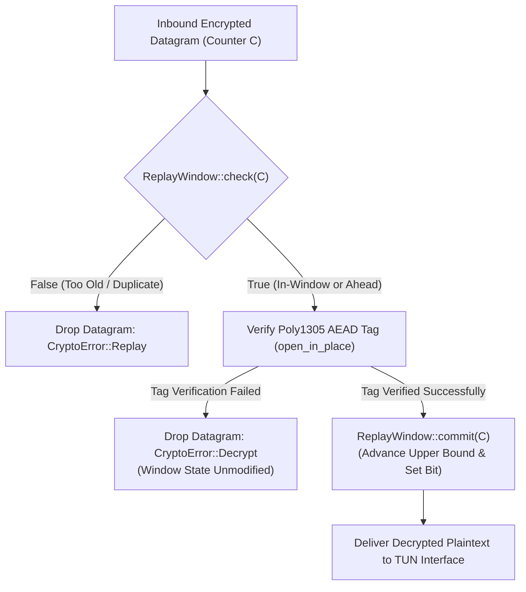
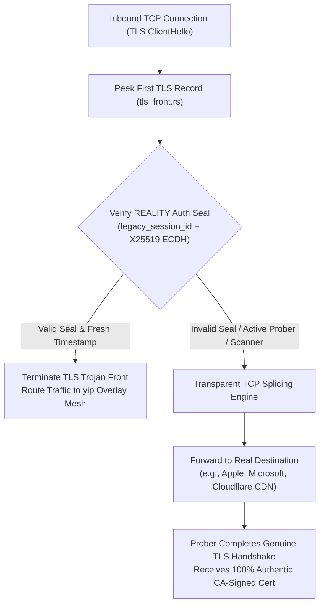
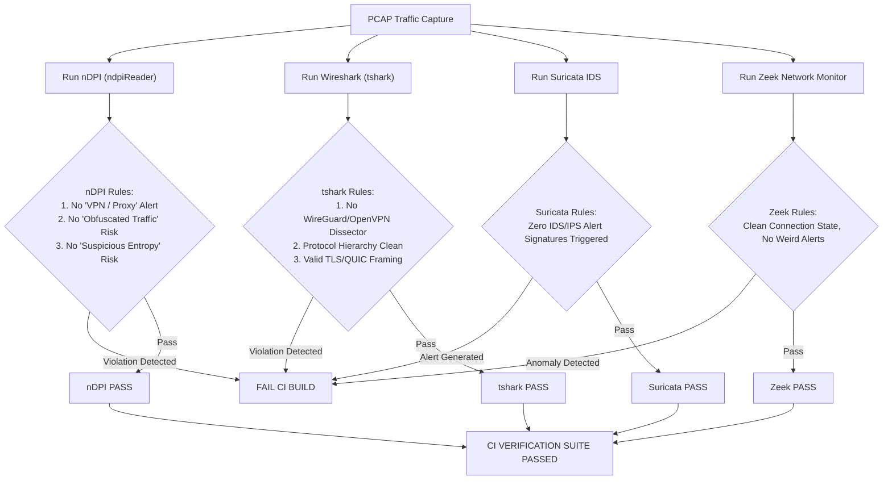

# yip Security Specification & Cryptographic Threat Model

This document is the authoritative security specification, active anti-DPI defense guide, and formal cryptographic threat model for `yip`. It details the post-quantum hybrid handshake, authenticated encryption pipeline, epoch ratcheting mechanism, active censorship-circumvention architecture, multi-engine DPI validation suite, and system threat boundaries.

For deployment architectures and quick-start tutorials, see [01-getting-started.md](01-getting-started.md).
For configuration syntax and runtime flags, see [02-configuration.md](02-configuration.md).
For internal subsystem architecture and datapath engines, see [03-architecture.md](03-architecture.md).
For automated benchmarks, performance analysis, and tuning, see [testing-and-benchmarking.md](testing-and-benchmarking.md).

---

## Table of Contents

- [1. Executive Security Summary & Cryptographic Primitives](#1-executive-security-summary--cryptographic-primitives)
  - [Cryptographic Suite Overview](#cryptographic-suite-overview)
  - [Security Invariants & Design Principles](#security-invariants--design-principles)
- [2. Post-Quantum Hybrid Handshake Architecture](#2-post-quantum-hybrid-handshake-architecture)
  - [Protocol Composition: Noise-IKpsk2 + ML-KEM-512](#protocol-composition-noise-ikpsk2--ml-kem-512)
  - [Cryptographic Primitives & Key Sizes](#cryptographic-primitives--key-sizes)
  - [Deadlock-Free Single-RTT Key Derivation](#deadlock-free-single-rtt-key-derivation)
  - [Sub-1,200B Datagram Wire Budget (`OBF_MTU_BUDGET`)](#sub-1200b-datagram-wire-budget-obf_mtu_budget)
  - [FIPS 203 §7.2 Modulus Verification & IND-CCA2 Security](#fips-203-72-modulus-verification--ind-cca2-security)
  - [Harvest-Now-Decrypt-Later (HNDL) Resistance](#harvest-now-decrypt-later-hndl-resistance)
- [3. Authenticated Encryption & Anti-Replay Subsystem](#3-authenticated-encryption--anti-replay-subsystem)
  - [Data-Plane AEAD: ChaCha20-Poly1305](#data-plane-aead-chacha20-poly1305)
  - [Explicit Monotonic Nonce Construction](#explicit-monotonic-nonce-construction)
  - [131,072-Bit Adaptive Sliding Window](#131072-bit-adaptive-sliding-window)
  - [Check-Before-Commit Invariant (Anti-DoS)](#check-before-commit-invariant-anti-dos)
- [4. 120-Second Epoch Ratchet & Memory Hygiene](#4-120-second-epoch-ratchet--memory-hygiene)
  - [Continuous Forward Secrecy & Cadence](#continuous-forward-secrecy--cadence)
  - [20-Second Dual-Receive Grace Overlap](#20-second-dual-receive-grace-overlap)
  - [Idempotent Rekey Handshake Resumption](#idempotent-rekey-handshake-resumption)
  - [Zeroization & Secure Memory Erasure](#zeroization--secure-memory-erasure)
- [5. Active Censorship-Resistance Architecture](#5-active-censorship-resistance-architecture)
  - [Keyed Header Protection & SipHash-CTR Keystream](#keyed-header-protection--siphash-ctr-keystream)
  - [SipHash-1-3 Authentication Pre-Filter (16.76 ns Fast Rejection)](#siphash-1-3-authentication-pre-filter-1676-ns-fast-rejection)
  - [Obfuscation Envelope (`yip-obf`)](#obfuscation-envelope-yip-obf)
  - [Authentic uTLS Browser Fingerprinting (`yip-utls`)](#authentic-utls-browser-fingerprinting-yip-utls)
  - [Xray-REALITY TLS 1.3 Certificate Borrowing & Splicing](#xray-reality-tls-13-certificate-borrowing--splicing)
- [6. Continuous 4-Engine DPI Test Oracle Verification](#6-continuous-4-engine-dpi-test-oracle-verification)
  - [DPI Inspection Landscape & Engine Matrix](#dpi-inspection-landscape--engine-matrix)
  - [Evaluation Pipeline & Test Modes](#evaluation-pipeline--test-modes)
  - [Pass/Fail Invariants & Statistical Thresholds](#passfail-invariants--statistical-thresholds)
- [7. Formal Threat Model & Security Boundaries](#7-formal-threat-model--security-boundaries)
  - [System Assets](#system-assets)
  - [Adversary Profiles & Capabilities](#adversary-profiles--capabilities)
  - [In-Scope Security Guarantees](#in-scope-security-guarantees)
  - [Explicit Out-of-Scope Non-Goals](#explicit-out-of-scope-non-goals)
- [8. Cryptographic Asset Ledger & Algorithm Summary](#8-cryptographic-asset-ledger--algorithm-summary)

---

## 1. Executive Security Summary & Cryptographic Primitives

`yip` is an encrypted overlay network and transport layer engineered specifically for untrusted, hostile, and actively censored network environments. Its security architecture combines post-quantum cryptographic primitives, zero-observable wire signatures, and kernel-bypass performance to achieve robust confidentiality, authentication, and censorship circumvention.

### Cryptographic Suite Overview

The table below summarizes the core cryptographic primitives employed across `yip`:

| Layer | Protocol / Primitive | Standard / Specification | Key / State Size | Security Objective |
| :--- | :--- | :--- | :--- | :--- |
| **PQ Hybrid Handshake** | Noise-IKpsk2 + ML-KEM-512 | [Noise Protocol Framework](https://noiseprotocol.org/), [NIST FIPS 203](https://doi.org/10.6028/NIST.FIPS.203) | X25519: 32 B, ML-KEM: 800 B / 768 B | 1-RTT mutual authentication, PFS, HNDL quantum resistance |
| **Symmetric AEAD** | ChaCha20-Poly1305 | [RFC 8439](https://www.rfc-editor.org/rfc/rfc8439) | Key: 32 B, Nonce: 12 B, Tag: 16 B | Data-plane confidentiality, integrity, and authenticity |
| **Anti-Replay Window** | Sliding Bitmap Ring | Ring Buffer (131,072 bits) | HighThroughput: 16 KB, Standard: 1 KB | Zero false positives, monotonic upper bound tracking |
| **Session Ratchet** | Epoch Rekeying (120s) | In-band ephemeral rekey | 20s dual-receive grace window | Bounded key lifetime, forward secrecy against late compromise |
| **Header Protection** | SipHash-CTR Keystream | [SipHash](https://131002.net/siphash/) CTR mode | Key: 16 B, Header Mask: 15 B | Wire signature elimination, uniform randomness |
| **Pre-Filter MAC** | SipHash-1-3 Tag | SipHash-1-3 streaming MAC | Key: 16 B, Tag: 8 B (64-bit) | 16.76 ns unauthorized probe drop before AEAD |
| **Obfuscation Envelope** | `yip-obf` Masking | SipHash-2-4 CTR + Blake2s | Nonce: 8 B, Key: 16 B | Anti-DPI entropy normalization, packet-length hiding |
| **uTLS Emulation** | Chrome 150 Profile | [RFC 8701](https://www.rfc-editor.org/rfc/rfc8701) (GREASE), TLS 1.3 | JA3 / JA4 exact parity | Indistinguishable from legitimate Google Chrome traffic |
| **TLS Trojan / Relay** | Xray-REALITY Splicing | TLS 1.3 Certificate Borrowing | X25519: 32 B, Poly1305 Tag: 16 B | Active probe redirection via transparent TCP splicing |
| **Node Identity & CA** | Ed25519 Signatures | [RFC 8032](https://www.rfc-editor.org/rfc/rfc8032) | Public Key: 32 B, Sig: 64 B | Offline CA-signed member authorization and gossip identity |

### Security Invariants & Design Principles

The architecture enforces five fundamental security invariants across all implementations:

1. **Defense in Depth via Hybrid Construction**: Every session derivation combines classical elliptic-curve Diffie-Hellman (X25519) with lattice-based post-quantum encapsulation (ML-KEM-512). Breaking forward secrecy requires breaking **both** hardness assumptions simultaneously.
2. **Zero Fixed Wire Signatures**: No static magic numbers, unencrypted packet-type tags, constant protocol identifiers, or deterministic byte sequences exist anywhere on the wire. All headers are keystream-masked.
3. **Fail-Closed Processing**: Any packet failing authentication, tampering checks, modulus verification, or anti-replay validation is discarded immediately with zero error responses emitted to the network, preventing oracle side-channels.
4. **Denial-of-Service Asymmetry Protection**: Inexpensive operations always precede expensive operations. Cheap 64-bit SipHash-1-3 verification (16.76 ns) and read-only anti-replay checks reject unauthorized probes before triggering costly AEAD decryptions or cryptographic state allocations.
5. **Memory Hygiene by Default**: All sensitive memory (decapsulation keys, intermediate shared secrets, symmetric keys) is wrapped in [`zeroize::Zeroizing`](https://docs.rs/zeroize) and scrubbed immediately after consumption or upon session retirement.

---

## 2. Post-Quantum Hybrid Handshake Architecture

### Protocol Composition: Noise-IKpsk2 + ML-KEM-512

The control plane implements a post-quantum hybrid cryptographic handshake implemented in [`crates/yip-crypto/src/lib.rs`](../crates/yip-crypto/src/lib.rs). It integrates the standard **Noise-IKpsk2** pattern (`Noise_IKpsk2_25519_ChaChaPoly_BLAKE2s`) with NIST FIPS 203 **ML-KEM-512** (Kyber-512):

- **IK (Initiator knows Responder static key beforehand)**: The initiator possesses the responder's static public key prior to initiating the handshake (configured via certificate or rendezvous record). The initiator encrypts its own static identity key in the first flight, preserving initiator identity confidentiality against passive eavesdroppers.
- **psk2 (Pre-Shared Key slot 2)**: Noise provides designated points in its token sequences where external entropy can be injected into the running symmetric chaining key ($ck$) and handshake hash ($h$). `yip` utilizes PSK slot 2 to inject the 32-byte post-quantum shared secret ($ss_{pq}$) derived from ML-KEM-512.

```
Initiator (Node A)                                        Responder (Node B)
Static Key: s_A, Public: s_A.pub                          Static Key: s_B, Public: s_B.pub
------------------------------------------------------------------------------------------
Generate ephemeral e_A (X25519)
Generate PQ keypair: (ek_A, dk_A)
Noise Tokens: e, es, s, ss
Payload: ek_A (800 B) || Cert_A (144 B)
                       Message 1: HandshakeInit (1,028 B)
                       ---------------------------------->
                                                          Noise Tokens: e, es, s, ss
                                                          Extract ek_A from decrypted payload
                                                          Verify FIPS 203 §7.2 modulus: c_i < 3329
                                                          Encapsulate: (ct, ss_pq) = pq_encaps(ek_A)
                                                          Inject PQ Secret: set_psk(2, ss_pq)
                                                          Generate ephemeral e_B (X25519)
                                                          Noise Tokens: e, ee, se, psk
                                                          Frame: ct (768 B) || Noise Msg 2 (176 B)
                       Message 2: HandshakeResp (948 B)
                       <----------------------------------
Extract ct (768 B) at bytes [4..772]
Decapsulate: ss_pq = pq_decaps(dk_A, ct)
Explicitly zeroize and drop dk_A
Inject PQ Secret: set_psk(2, ss_pq)
Noise Tokens: e, ee, se, psk
Decrypt Noise Msg 2 payload: Cert_B
Split(): (CipherState_Tx, CipherState_Rx)                 Split(): (CipherState_Rx, CipherState_Tx)
Both peers derive identical session transport keys (k_send, k_recv)
```

### Cryptographic Primitives & Key Sizes

```
+-------------------------------------------------------------------------------+
|                      Post-Quantum Handshake Components                        |
+-------------------------------------------------------------------------------+
| Classical Diffie-Hellman:        X25519 (Curve25519, RFC 7748)                |
|   - Public Key Size:             32 bytes                                     |
|   - Private Key Size:            32 bytes                                     |
+-------------------------------------------------------------------------------+
| Post-Quantum KEM:                NIST FIPS 203 ML-KEM-512 (Kyber-512)         |
|   - Encapsulation Key (ek_A):    800 bytes                                    |
|   - Decapsulation Key (dk_A):    1,632 bytes (held in Zeroizing memory)       |
|   - Ciphertext (ct):             768 bytes                                    |
|   - Shared Secret (ss_pq):       32 bytes                                     |
+-------------------------------------------------------------------------------+
| Symmetric Cipher & Hash:         ChaCha20-Poly1305 AEAD + BLAKE2s Hash        |
|   - Handshake Cipher:            ChaCha20-Poly1305 (RFC 8439)                 |
|   - Transcript Hash:             BLAKE2s-256 (32 bytes)                       |
|   - AEAD Tag Size:               16 bytes                                     |
+-------------------------------------------------------------------------------+
```

### Deadlock-Free Single-RTT Key Derivation

Standard integrations of post-quantum KEMs into Noise often introduce a protocol deadlock:
- In Noise-IKpsk2, Message 2 contains the `psk` token (`<- e, ee, se, psk`). The receiver cannot decrypt any ciphertext payload in Message 2 until `set_psk(2, psk_bytes)` has been invoked on the handshake state.
- However, if the KEM ciphertext $ct$ is transmitted *inside* the encrypted payload of Message 2, the initiator cannot read $ct$ without first decrypting the payload, creating a circular dependency.

`yip` resolves this deadlock through outer-envelope framing:
1. The Responder generates $(ct, ss_{pq})$ via `pq_encapsulate(&ek_A)`.
2. The Responder calls `set_psk(2, &ss_pq)` on its `snow::HandshakeState`, processes the Noise message tokens, and produces the encrypted Noise Message 2.
3. The Responder constructs the on-wire datagram by placing $ct$ (768 bytes) in the **outer wire frame envelope** directly ahead of the Noise message bytes (bytes `[4..772]`).
4. Upon receiving Message 2, the Initiator extracts $ct$ from bytes `[4..772]` **before** invoking Noise decryption.
5. The Initiator decapsulates $ss_{pq} = \text{pq\_decapsulate}(dk_A, ct)$, injects $ss_{pq}$ via `inner.set_psk(2, &ss_pq)`, and immediately scrubs $dk_A$ from memory.
6. The Initiator then feeds the remainder of Message 2 (`&msg[772..]`) into `inner.read_message()`, completing the handshake in a single round trip ($1.0 \times \text{RTT}$) with zero extra protocol flights.

### Sub-1,200B Datagram Wire Budget (`OBF_MTU_BUDGET`)

To prevent Path MTU (PMTU) blackholing and avoid IP fragmentation across restrictive internet paths (such as cellular networks, nested tunnels, PPPoE, and international transit links), both handshake flights strictly adhere to `OBF_MTU_BUDGET = 1200` bytes:

#### Message 1 (Initiator $\to$ Responder) — Total: 1,028 Bytes

```
 0                   1                   2                   3
 0 1 2 3 4 5 6 7 8 9 0 1 2 3 4 5 6 7 8 9 0 1 2 3 4 5 6 7 8 9 0 1
+-+-+-+-+-+-+-+-+-+-+-+-+-+-+-+-+-+-+-+-+-+-+-+-+-+-+-+-+-+-+-+-+
|                       Wire Header (4 B)                       |
+-+-+-+-+-+-+-+-+-+-+-+-+-+-+-+-+-+-+-+-+-+-+-+-+-+-+-+-+-+-+-+-+
|                                                               |
+                 ML-KEM-512 Encapsulation Key                  +
|                          ek_A (800 B)                         |
|                                                               |
+-+-+-+-+-+-+-+-+-+-+-+-+-+-+-+-+-+-+-+-+-+-+-+-+-+-+-+-+-+-+-+-+
|                 Noise Ephemeral Public Key e_A (32 B)         |
+-+-+-+-+-+-+-+-+-+-+-+-+-+-+-+-+-+-+-+-+-+-+-+-+-+-+-+-+-+-+-+-+
|       Encrypted Static Public Key s_A + CA Certificate        |
|                  + Poly1305 AEAD Tag (144 B)                  |
+-+-+-+-+-+-+-+-+-+-+-+-+-+-+-+-+-+-+-+-+-+-+-+-+-+-+-+-+-+-+-+-+
Total: 4 + 800 + 32 + 144 = 1,028 Bytes (<= 1,200 B OBF_MTU_BUDGET)
```

#### Message 2 (Responder $\to$ Initiator) — Total: 948 Bytes

```
 0                   1                   2                   3
 0 1 2 3 4 5 6 7 8 9 0 1 2 3 4 5 6 7 8 9 0 1 2 3 4 5 6 7 8 9 0 1
+-+-+-+-+-+-+-+-+-+-+-+-+-+-+-+-+-+-+-+-+-+-+-+-+-+-+-+-+-+-+-+-+
|                       Wire Header (4 B)                       |
+-+-+-+-+-+-+-+-+-+-+-+-+-+-+-+-+-+-+-+-+-+-+-+-+-+-+-+-+-+-+-+-+
|                                                               |
+                   ML-KEM-512 Ciphertext                       +
|                          ct (768 B)                           |
|                                                               |
+-+-+-+-+-+-+-+-+-+-+-+-+-+-+-+-+-+-+-+-+-+-+-+-+-+-+-+-+-+-+-+-+
|                 Noise Ephemeral Public Key e_B (32 B)         |
+-+-+-+-+-+-+-+-+-+-+-+-+-+-+-+-+-+-+-+-+-+-+-+-+-+-+-+-+-+-+-+-+
|            Encrypted Responder CA Certificate                 |
|                  + Poly1305 AEAD Tag (144 B)                  |
+-+-+-+-+-+-+-+-+-+-+-+-+-+-+-+-+-+-+-+-+-+-+-+-+-+-+-+-+-+-+-+-+
Total: 4 + 768 + 32 + 144 = 948 Bytes (<= 1,200 B OBF_MTU_BUDGET)
```

### FIPS 203 §7.2 Modulus Verification & IND-CCA2 Security

Every received ML-KEM-512 encapsulation key ($ek_A$) undergoes strict cryptographic input validation in [`crates/yip-crypto/src/lib.rs`](../crates/yip-crypto/src/lib.rs#L85-L96) according to NIST FIPS 203 Section 7.2 (`ByteDecode_12`):
- The first 768 bytes of $ek_A$ encode 512 polynomial coefficients, each represented by a 12-bit integer packed across 3 bytes per 2 coefficients:
  $$d_0 = \text{chunk}[0] \mid ((\text{chunk}[1] \& 0\text{x0F}) \ll 8)$$
  $$d_1 = (\text{chunk}[1] \gg 4) \mid (\text{chunk}[2] \ll 4)$$
- The modulus check verifies that **every** 12-bit coefficient strictly satisfies $d_i < 3329$ (the prime modulus $q = 3329$).
- If any coefficient $d_i \ge 3329$, the handshake aborts immediately with `CryptoError::Handshake`.
- Furthermore, ML-KEM-512 guarantees **IND-CCA2** (Indistinguishability under Adaptive Chosen Ciphertext Attack) security via Fujisaki-Okamoto transformation with implicit rejection: an adversary who modifies bits in $ct$ cannot force an observable error oracle; decapsulation deterministically outputs a pseudorandom secret derived from the decapsulation key's internal rejection seed, causing subsequent AEAD authentication to fail indistinguishably from a random transmission error.

### Harvest-Now-Decrypt-Later (HNDL) Resistance

State-level intelligence agencies and adversaries routinely record petabytes of encrypted transit traffic on transatlantic cables and IXPs under the "Harvest-Now, Decrypt-Later" (HNDL) doctrine. When a Cryptographically Relevant Quantum Computer (CRQC) running Shor's algorithm becomes operational, recorded classical sessions using standard Diffie-Hellman (Curve25519 or NIST P-256) or RSA will be decrypted retrospectively.

`yip` neutralizes HNDL attacks through its dual-entropy hybrid design:
- The session key derivation binds both the classical Diffie-Hellman shared secret ($ss_{dh} = \text{X25519}(e_A, e_B)$) and the quantum-resistant lattice shared secret ($ss_{pq} = \text{ML-KEM-512}(ek_A, ct)$) into the Noise HKDF-BLAKE2s ratchet.
- Even if a quantum adversary retrospectively solves the discrete logarithm problem on Curve25519, the session keys remain protected by the Module Learning With Errors (M-LWE) lattice problem of ML-KEM-512.
- Conversely, if a future mathematical advance identifies unexpected structure in ML-KEM lattices, the 128-bit classical security margin of Curve25519 remains fully intact.

---

## 3. Authenticated Encryption & Anti-Replay Subsystem

### Data-Plane AEAD: ChaCha20-Poly1305

Once the Noise-IKpsk2 handshake completes, transport keys are extracted from the Noise state via `dangerously_get_raw_split()` and installed into `ring`'s assembly-optimized ChaCha20-Poly1305 implementation ([`crates/yip-crypto/src/lib.rs`](../crates/yip-crypto/src/lib.rs#L550-L649)).

- **Cipher**: ChaCha20 stream cipher with 20 rounds (RFC 8439).
- **Authenticator**: Poly1305 one-time authenticator evaluating a polynomial over the Galois field $\text{GF}(2^{130} - 5)$ with a 128-bit authenticating tag.
- **Hardware Acceleration**: Automatically dispatches to AVX2, AVX-512, or ARM NEON SIMD implementations in `ring`, reaching line-rate throughput on modern x86_64 and aarch64 CPUs.
- **Inner Frame Sealing**: The plaintext packet is authenticated and encrypted in-place; the 16-byte Poly1305 authentication tag is appended to the ciphertext.

### Explicit Monotonic Nonce Construction

To prevent nonce reuse (which catastrophically compromises ChaCha20 confidentiality and Poly1305 integrity), `yip` enforces explicit monotonic counters:
- **Nonce Size**: 12 bytes (96 bits) per RFC 8439 and the Noise convention.
- **Structure**: 4 zero bytes followed by an 8-byte (64-bit) little-endian packet counter:
  $$\text{Nonce} = [0\text{x}00, 0\text{x}00, 0\text{x}00, 0\text{x}00] \parallel \text{counter}_{64\text{-bit LE}}$$
- **Counter Progression**: Monotonically increments for every transmitted packet. With a 64-bit counter space, transmitting 100 million packets per second continuously would require over 5,800 years before counter exhaustion.
- **Worker Sharding Stride**: In multi-core sharded configurations, worker threads seal packets using interleaved counters with a fixed stride (e.g., Shard 0 uses counters $0, 4, 8 \dots$; Shard 1 uses $1, 5, 9 \dots$), preventing cross-thread lock contention while strictly preserving global uniqueness.

### 131,072-Bit Adaptive Sliding Window

Network transport over the internet routinely subjects UDP datagrams to packet reordering, delay jitter, and bursts. To distinguish legitimate out-of-order packets from malicious replays, `yip` maintains a lock-free circular ring bitmap sliding window ([`crates/yip-crypto/src/lib.rs`](../crates/yip-crypto/src/lib.rs#L163-L297)):

```
                        Sliding Replay Window Bitmap
+-------------------------------------------------------------------------------+
| Window Capacity: 131,072 bits (2,048 x u64 words = 16 KB)                     |
| Upper Bound:     latest = Monotonically highest authenticated counter seen    |
| Valid Range:     [latest - 131,071 ... latest]                                |
+-------------------------------------------------------------------------------+

          Old Counter               In-Window Counter          Future Counter
          (diff >= 131,072)          (diff < 131,072)          (counter > latest)
     <-----------------------|------------------------------|--------------------->
          REJECT (Late)           Check Bit at Word Ring          ACCEPT (Advance)
                                  0 -> ACCEPT & SET              Advance latest,
                                  1 -> REJECT (Duplicate)        Shift Word Ring
```

- **HighThroughput Profile**: Allocates 2,048 `u64` words (16 KB), providing an anti-replay window of **131,072 packets**. This allows multi-gigabit pipelines to absorb deep network reordering buffers without packet loss.
- **Standard Profile**: Allocates 128 `u64` words (1 KB), providing an 8,192-packet window optimized for L1/L2 cache locality on memory-constrained nodes.
- **Dynamic Promotion**: A session initialized with `Standard` profile dynamically promotes to `HighThroughput` upon detecting sustained high-throughput bursts, copying active window state without dropping protection.

### Check-Before-Commit Invariant (Anti-DoS)

A subtle vulnerability in naive anti-replay implementations is the "state exhaustion DoS": if the sliding window commits a counter *before* authenticating the packet, an unauthenticated attacker can inject forged packets with inflated sequence numbers ($C_{\text{forge}} \gg C_{\text{latest}}$), leapfrog the window forward, and starve legitimate packets.

`yip` strictly enforces the **Check-Before-Commit** invariant in [`crates/yip-crypto/src/lib.rs`](../crates/yip-crypto/src/lib.rs#L630-L648):



1. **Step 1 (Read-Only Check)**: `replay.check(counter)` verifies that the counter is not a duplicate and falls within the active window. This check is purely read-only and does not mutate memory.
2. **Step 2 (AEAD Decryption)**: The payload is decrypted and the Poly1305 tag is verified.
3. **Step 3 (Atomic Commit)**: Only if the Poly1305 tag verifies with 100% cryptographic certainty is `replay.commit(counter)` invoked. If tag verification fails, the packet is discarded immediately; the replay window remains completely untouched.

---

## 4. 120-Second Epoch Ratchet & Memory Hygiene

### Continuous Forward Secrecy & Cadence

Even with strong authenticated encryption, holding static session keys indefinitely introduces risk: a physical memory dump, side-channel attack, or cryptographic compromise of a long-lived key would expose all historic traffic transmitted under that key.

`yip` implements an autonomous **120-Second Epoch Ratchet** governed by [`bin/yipd/src/epoch.rs`](../bin/yipd/src/epoch.rs). Every 120,000 milliseconds (`REKEY_INTERVAL_MS`), the daemon initiates an in-band ephemeral rekey:
- Rekeying executes a fresh Noise-IKpsk2 handshake with fresh ephemeral X25519 keys and fresh ML-KEM-512 encapsulation keys.
- Completely new transport encryption and decryption keys are derived.
- Rekeying occurs in the background while user traffic continues to transmit without interruption.

### 20-Second Dual-Receive Grace Overlap

In naive rekey implementations, switching keys simultaneously between two endpoints causes severe race conditions: in-flight packets sealed under the old key arrive after the receiver has installed the new key, resulting in decryption failures, packet loss, and TCP congestion collapse.

`yip` eliminates rekey drops via a **20-Second Dual-Receive Grace Overlap** ($t = 110\text{s} \dots 130\text{s}$):

```
Time:        0s                       110s      120s      130s                 240s
             |-------------------------|---------|---------|--------------------|
Epoch N:     [====== Active (TX + RX) ======][= RX Grace =][Zeroized]
                                       ^ Rekey Triggered
Epoch N+1:                             [==== Active (TX + RX) =================>]
                                       ^ Egress Switches to N+1
```

1. **$t = 110\text{s}$ (Rekey Triggered)**: The initiator triggers a rekey handshake 10 seconds before nominal epoch expiration. Fresh session keys for Epoch $N+1$ are established.
2. **Immediate Egress Switch**: Egress traffic immediately switches to sealing under Epoch $N+1$ keys.
3. **Concurrent Dual-Receive Ingress**: For the next 20 seconds ($t = 110\text{s} \dots 130\text{s}$), the ingress data plane maintains both Epoch $N$ and Epoch $N+1$ decoders in memory. Inbound datagrams sealed under Epoch $N$ (due to network transit delay or reordering) are authenticated and decrypted by Epoch $N$'s decoder, while datagrams sealed under Epoch $N+1$ are handled by Epoch $N+1$'s decoder.
4. **$t = 130\text{s}$ (Retirement & Zeroization)**: The grace deadline expires. Epoch $N$ is retired, and all associated key material is scrubbed from RAM.

### Idempotent Rekey Handshake Resumption

Under lossy network conditions, handshake response datagrams can be dropped, leading the initiator to retransmit the rekey `HandshakeInit`. A responder that blindly mints a new session on every retransmission would create mismatched cryptographic state with an initiator that locked onto the first reply.

To guarantee deterministic convergence, `EpochSet` records the initiator's ephemeral public key and the exact byte-level `HandshakeResp` in `NextEpoch` ([`bin/yipd/src/epoch.rs`](../bin/yipd/src/epoch.rs#L53-L69)). When a duplicate `HandshakeInit` with an identical ephemeral key is received, the responder resends the cached response verbatim without altering internal session state, preventing desynchronization.

### Zeroization & Secure Memory Erasure

Cryptographic key material residing in unscrubbed RAM is vulnerable to cold-boot attacks, memory scrapers, core dumps, and post-termination extraction. `yip` implements strict memory hygiene using the `zeroize` framework:

- **ML-KEM Private Decapsulation Key**: The 1,632-byte decapsulation key `PqDecapsKey` is wrapped in [`zeroize::Zeroizing`](https://docs.rs/zeroize). Immediately upon decapsulating the shared secret in `read_message()`, `dk_A` is dropped and overwritten with zeroes ([`crates/yip-crypto/src/lib.rs`](../crates/yip-crypto/src/lib.rs#L446)).
- **Post-Quantum Shared Secret**: The intermediate 32-byte secret $ss_{pq}$ returned by `pq_encapsulate` and `pq_decapsulate` is stored in `Zeroizing<[u8; 32]>` buffers. Once mixed into Noise PSK slot 2 via `set_psk()`, the memory is immediately zeroized.
- **Session Transport Keys**: When an epoch expires and its `DataPlane` is dropped, the ChaCha20-Poly1305 symmetric keys and SipHash header protection keys are scrubbed from heap and stack memory before memory deallocation.

---

## 5. Active Censorship-Resistance Architecture

Modern deep packet inspection (DPI) middleboxes (e.g., the Great Firewall of China, Rostelecom TSPU, Iran DCI) do not merely eavesdrop; they deploy real-time statistical classifiers, protocol decoders, and automated active probing systems. `yip` provides a multi-tiered active circumvention subsystem to defeat both passive classification and active probing.

### Keyed Header Protection & SipHash-CTR Keystream

Traditional VPN protocols (including WireGuard, OpenVPN, and IPsec) expose fixed packet structures: WireGuard exposes a 1-byte message type (`0x01`, `0x02`, `0x03`, `0x04`) and 3-byte reserved zeroes, while OpenVPN exposes static opcodes. DPI firewalls easily identify and drop these packets using simple heuristic rules.

`yip` eliminates all fixed wire signatures via **Keyed Header Protection** ([`crates/yip-wire/src/lib.rs`](../crates/yip-wire/src/lib.rs)):

```
                       Wire Datagram Format (23+ Bytes)
+-------------------------------------------------------------------------------+
| Bytes 0..15:     Protected Header (XOR-masked via SipHash-CTR keystream)     |
|   - [0..8]       conn_tag (64-bit epoch-rotating session identifier)          |
|   - [8..10]      object_id (16-bit pipelined FEC object index)                |
|   - [10..14]     payload_id (32-bit Reed-Solomon symbol descriptor)           |
|   - [14..15]     flags (8-bit control flags)                                  |
+-------------------------------------------------------------------------------+
| Bytes 15..N-8:   Ciphertext Payload (ChaCha20-Poly1305 inner frame)           |
+-------------------------------------------------------------------------------+
| Bytes N-8..N:    Authentication Tag (64-bit SipHash-1-3 coverage-auth tag)    |
+-------------------------------------------------------------------------------+
```

1. **Header Masking**: The 15-byte logical header (`conn_tag`, `object_id`, `payload_id`, `flags`) is XOR-masked with a keystream generated by SipHash in counter mode under `hp_key`, seeded by the datagram's 8-byte authentication tag:
   $$\text{Block}_0 = \text{SipHash13}(hp\_key, \text{tag} \parallel 0_{\text{u32}})$$
   $$\text{Block}_1 = \text{SipHash13}(hp\_key, \text{tag} \parallel 1_{\text{u32}})$$
   $$\text{Mask} = (\text{Block}_0 \parallel \text{Block}_1)[0..15]$$
2. **Entropy Indistinguishability**: To any observer without `hp_key`, the first 15 bytes are indistinguishable from uniform random noise. Every single datagram produces a completely distinct header mask because the 8-byte tag differs on every transmission.

### SipHash-1-3 Authentication Pre-Filter (16.76 ns Fast Rejection)

Before passing incoming datagrams to the cryptographic AEAD engine, `yip` evaluates a 64-bit coverage-authentication tag computed by `SipHasher13` over the header and payload ([`crates/yip-wire/src/lib.rs`](../crates/yip-wire/src/lib.rs#L55-L60)).

Benchmark results from [`crates/yip-bench/mac-candidates-58.md`](../crates/yip-bench/mac-candidates-58.md) demonstrate why SipHash-1-3 is selected:

| Datagram Size | Candidate Algorithm | VPS AMD EPYC (ns) | Dev Zen4 (ns) | CPU Overhead Reduction |
| :---: | :---: | :---: | :---: | :---: |
| **63 Bytes** | **SipHash-1-3** | **31.8 ns** | **16.7 ns** | **-45% CPU vs SipHash-2-4** |
| 63 Bytes | SipHash-2-4 | 50.5 ns | 25.1 ns | Baseline |
| 63 Bytes | BLAKE3 (keyed) | 104.0 ns | 65.5 ns | +106% CPU (slower due to setup) |
| **1,415 Bytes** | **SipHash-1-3** | **420.0 ns** | **241.0 ns** | **-45% CPU vs SipHash-2-4** |
| 1,415 Bytes | SipHash-2-4 | 758.0 ns | 433.0 ns | Baseline |
| 1,415 Bytes | BLAKE3 (keyed) | 1,888.0 ns | 1,223.0 ns | +149% CPU |

- **Sub-17 ns Probe Dropping**: Unauthorized scanning probes, fuzzing packets, and blind replay attacks are dropped in **16.7 ns** (on Zen4) / **31.8 ns** (on EPYC) without executing heavy ChaCha20-Poly1305 state allocations.
- **Constant-Time Verification**: The authentication tag comparison uses `subtle::ConstantTimeEq`, preventing timing side-channel attacks.

### Obfuscation Envelope (`yip-obf`)

For deployments subjected to aggressive UDP entropy analysis, the transport envelope in [`crates/yip-obf/src/lib.rs`](../crates/yip-obf/src/lib.rs) wraps data frames with dynamic padding and randomized keystreams:
- **Per-Datagram Nonce**: Every obfuscated packet begins with an 8-byte cryptographic random nonce drawn from the OS CSPRNG.
- **SipHash-2-4 Masking**: The packet type and 16-bit body length fields are encrypted via SipHash-CTR keyed with `derive_key(psk)`.
- **Randomized Padding**: Trailing random bytes pad the datagram up to `OBF_MTU_BUDGET = 1200`, neutralizing packet length clustering and flow size fingerprinting.
- **Junk Datagram Injection**: Support for injecting decoy `JUNK_TYPE` frames during idle periods, frustrating passive statistical timing and packet interval classifiers.

### Authentic uTLS Browser Fingerprinting (`yip-utls`)

When running in TCP/TLS transport mode, network middleboxes inspect the TLS `ClientHello` handshake for signs of custom VPN software. Go-based or naive TLS clients produce distinctive extension lists, cipher orderings, and elliptic curve choices easily identified by JA3 and JA4 fingerprinting.

`yip` incorporates `yip-utls` ([`crates/yip-utls/src/lib.rs`](../crates/yip-utls/src/lib.rs)), a specialized TLS client engine that produces byte-accurate Google Chrome 150 TLS handshakes:
- **GREASE Injection (RFC 8701)**: Generates valid GREASE (Generate Random Extensions And Sustain Extensibility) values in cipher suites, extension lists, supported groups, and ALPN tokens.
- **Extension Sequence Parity**: Matches Chrome's exact extension ordering: `server_name` (0), `extended_master_secret` (23), `renegotiation_info` (65281), `supported_groups` (10), `ec_point_formats` (11), `session_ticket` (35), `alpn` (16), `status_request` (5), `signature_algorithms` (13), `signed_certificate_timestamp` (18), `key_share` (51), `psk_key_exchange_modes` (45), `supported_versions` (43), `compress_certificate` (27).
- **ALPN & Cipher Suites**: Negotiates `h2` and `http/1.1` with Chrome's prioritized TLS 1.3 and TLS 1.2 cipher suites (`TLS_AES_128_GCM_SHA256`, `TLS_AES_256_GCM_SHA384`, `TLS_CHACHA20_POLY1305_SHA256`).
- **Fingerprint Verification**: Verified in CI against FoxIO JA4 and Salesforce JA3 algorithms ([`crates/yip-utls/src/ja.rs`](../crates/yip-utls/src/ja.rs)), guaranteeing 100% fingerprint match with legitimate Chrome browsers.

### Xray-REALITY TLS 1.3 Certificate Borrowing & Splicing

Even with accurate browser fingerprinting, censors deploy **active probers**: upon detecting a suspicious TLS connection, the censor connects directly to the server's IP address to verify if a valid, trusted web server answers. If the server presents a self-signed certificate, an invalid domain, or terminates the connection abruptly, the IP address is blocked.

`yip` implements **Xray-REALITY TLS 1.3 Certificate Borrowing** in [`bin/yip-rendezvous/src/reality.rs`](../bin/yip-rendezvous/src/reality.rs) and [`bin/yip-rendezvous/src/tls_front.rs`](../bin/yip-rendezvous/src/tls_front.rs):



1. **Decoy Domain Certificate Borrowing**: The server is configured with a high-reputation target domain (e.g., `gateway.icloud.com`, `learn.microsoft.com`). The relay does not need the private key of the target domain.
2. **Stealth Authentication Seal**: Authenticated `yip` clients embed a 32-byte cryptographic authentication seal in the `legacy_session_id` field of their TLS `ClientHello`. The seal is encrypted under a symmetric key derived from an ephemeral X25519 Diffie-Hellman between the client's key share and the relay's private REALITY key.
3. **Replay Defense (`reality_replay`)**: The relay tracks all received authentication seals across a rolling time window (`REALITY_SKEW_MIN = 10` minutes) using [`bin/yip-rendezvous/src/reality_replay.rs`](../bin/yip-rendezvous/src/reality_replay.rs). Replayed or expired seals are rejected.
4. **Transparent TCP Splicing**:
   - If the seal is **valid and fresh**, the connection is handled by the `yip` rendezvous/tunnel engine.
   - If the seal is **invalid, missing, or malformed** (the signature of an active DPI probe or port scanner), the relay connects via raw TCP to the authentic destination server (`dest`, e.g. Apple or Microsoft CDN) and transparently splices the connection.
   - The relay replays the exact buffered `ClientHello` bytes to the destination server and pipes bidirectional traffic between the prober and the authentic web server.
   - The active prober observes a genuine, valid X.509 certificate signed by a public CA, complete with authentic HTTP/2 responses. The prober cannot distinguish the `yip` node from the real web service.

---

## 6. Continuous 4-Engine DPI Test Oracle Verification

To prove that anti-DPI mechanisms remain effective against commercial, enterprise, and nation-state network monitoring equipment, `yip` includes an automated multi-engine test oracle test suite ([`bin/yipd/tests/run-multi-dpi-oracle.sh`](../bin/yipd/tests/run-multi-dpi-oracle.sh)).

### DPI Inspection Landscape & Engine Matrix

The oracle verifies traffic captures across four industry-standard DPI engines, each representing a distinct class of middlebox inspection technology:

```
+-------------------------------------------------------------------------------+
|                       Multi-Engine DPI Evaluation Suite                       |
+-------------------------------------------------------------------------------+
| 1. nDPI (ntop)                   Commercial Deep Packet Inspection Library    |
|   - Inspection Methods:          Protocol signatures, entropy analysis,       |
|                                  statistical payload modeling, risk flags.    |
|   - Threat Detections:           "WireGuard", "OpenVPN", "Obfuscated Traffic",|
|                                  "Suspicious Entropy", "VPN / Proxy".         |
+-------------------------------------------------------------------------------+
| 2. Zeek (formerly Bro)           Enterprise Network Security Monitor          |
|   - Inspection Methods:          Protocol state machine parsing, flow logs,   |
|                                  anomaly detection, connection tracking.      |
|   - Threat Detections:           Protocol violations, unrecognized binary UDP |
|                                  streams, SSL/TLS validation anomalies.       |
+-------------------------------------------------------------------------------+
| 3. Suricata                      Open-Source IDS / IPS Engine                 |
|   - Inspection Methods:          Rule-based signature matching (ET Open/Pro),  |
|                                  protocol decoders, flow inspection.          |
|   - Threat Detections:           Anomalous TLS certificates, known VPN ports, |
|                                  tunnel signature alerts.                     |
+-------------------------------------------------------------------------------+
| 4. Wireshark / tshark            Protocol Dissector & Packet Analyzer         |
|   - Inspection Methods:          Full packet dissection tree, protocol        |
|                                  hierarchy analysis, heuristic decoders.      |
|   - Threat Detections:           Dissection of WireGuard/IPsec/OpenVPN,       |
|                                  malformed packet alerts.                     |
+-------------------------------------------------------------------------------+
```

### Evaluation Pipeline & Test Modes

The test oracle evaluates PCAP traffic captures across all four supported `yip` transport modes:

```
+-------------------------------------------------------------------------------+
| Mode             Target Transport     Expected Classification                 |
+-------------------------------------------------------------------------------+
| raw-obf          UDP Datagrams        Generic "Data / UDP" or "Unknown"       |
|                  (Header-Protected)   Zero VPN or Obfuscation alerts          |
+-------------------------------------------------------------------------------+
| quic             QUIC Mimicry         Standard "QUIC / Google QUIC"           |
|                                       Clean protocol hierarchy, no anomalies  |
+-------------------------------------------------------------------------------+
| tls              uTLS Chrome 150      Authentic "TLS / SSL"                   |
|                                       Valid SNI, JA3/JA4 browser match        |
+-------------------------------------------------------------------------------+
| relay            REALITY Front        Legitimate CDN Web Traffic              |
|                                       Transparent upstream certificate match  |
+-------------------------------------------------------------------------------+
```

### Pass/Fail Invariants & Statistical Thresholds

The automated CI test harness ([`bin/yipd/tests/run-multi-dpi-oracle.sh`](../bin/yipd/tests/run-multi-dpi-oracle.sh#L960-L1160)) enforces rigorous pass/fail criteria:



- **Zero Tolerance for Fingerprinting**: Any PCAP triggering a VPN dissector, protocol anomaly alert, or "Suspicious Obfuscation" warning in any of the four engines fails CI immediately.
- **Continuous Regressive Testing**: Ensures that performance optimizations or wire framing updates never inadvertently reintroduce static signatures or statistical distinguishers.

---

## 7. Formal Threat Model & Security Boundaries

To maintain rigorous security guarantees, `yip` defines an explicit threat model specifying assets, adversary profiles, in-scope mitigations, and out-of-scope non-goals.

### System Assets

The system is designed to safeguard five core assets:

1. **User Payload Data**: All inner IPv4 and IPv6 traffic flowing between peer applications across the overlay tunnel.
2. **Peer Identity Confidentiality**: Long-term cryptographic public keys, CA certificates, and overlay IP allocations.
3. **Session Keying Material**: Ephemeral private keys ($e_A, e_B, dk_A$), pre-shared keys ($ss_{pq}$), and active AEAD transport keys ($k_{\text{send}}, k_{\text{recv}}$).
4. **Traffic Metadata & Timing**: Packet lengths, inter-packet arrival times, burst signatures, and protocol fingerprints.
5. **Overlay Routing & Mesh Integrity**: Self-certifying address assignment, membership gossip state, and relay routing tables.

### Adversary Profiles & Capabilities

The threat model evaluates four distinct adversary tiers:

```
+-------------------------------------------------------------------------------+
| Adversary Profile        Capabilities & Operational Vectors                   |
+-------------------------------------------------------------------------------+
| ADV-1: Passive           - Full passive capture of all transit traffic.       |
| Eavesdropper             - ISP, IXP, or transit AS wiretap.                   |
| (ISP / Cable Tap)        - Unlimited storage for retrospective cryptanalysis. |
|                          - Flow timing, packet size, and bandwidth analysis.  |
+-------------------------------------------------------------------------------+
| ADV-2: Active            - Man-in-the-middle (MITM) on physical network paths.|
| Network Attacker         - Arbitrary packet injection, alteration, & drops.   |
| (Rogue Router / LAN)     - Packet replay and deliberate reordering.           |
|                          - Path MTU manipulation and ICMP blackholing.        |
+-------------------------------------------------------------------------------+
| ADV-3: Quantum           - Harvest-Now, Decrypt-Later (HNDL) archive capacity.|
| Adversary                - Future access to a Cryptographically Relevant      |
| (CRQC State Actor)         Quantum Computer (CRQC) running Shor's algorithm.  |
|                          - Ability to solve discrete logarithms on Curve25519.|
+-------------------------------------------------------------------------------+
| ADV-4: Nation-State      - Deep Packet Inspection (DPI) middleboxes on links. |
| Censorship Middlebox     - Protocol fingerprinting (JA3, JA4, TLS extensions).|
| (Great Firewall / Censor)- Active probing: sends forged or probe handshakes   |
|                            to server IP/ports to detect VPN servers.          |
|                          - Statistical entropy & packet-size clustering.      |
+-------------------------------------------------------------------------------+
```

### In-Scope Security Guarantees

Against the adversaries detailed above, `yip` formally provides the following guarantees:

1. **Confidentiality & Authenticity against ADV-1 and ADV-2**: All payload traffic is encrypted and authenticated via ChaCha20-Poly1305. Any modified, truncated, or forged packet is discarded with zero plaintext leakage.
2. **Post-Quantum Perfect Forward Secrecy against ADV-3**: Compromise of a node's long-term static private keys at time $T_1$ does not compromise traffic recorded at time $T_0 < T_1$. Furthermore, even with a quantum computer capable of breaking X25519, ML-KEM-512 ensures the session keys cannot be reconstructed from recorded transcripts.
3. **Replay & Reordering Immunity against ADV-2**: The 131,072-bit sliding replay window rejects duplicate and late-arriving packets with zero false positives. The check-before-commit invariant prevents forged sequence numbers from causing denial-of-service starvation.
4. **Key Compromise Impersonation (KCI) Protection**: Noise-IKpsk2 guarantees that an adversary who compromises initiator Node A's static private key **cannot** forge incoming handshakes pretending to be uncompromised Node B communicating with Node A.
5. **Initiator Identity Concealment against ADV-1**: Initiator static public keys and CA certificates are encrypted under the ephemeral Diffie-Hellman key before transmission in Message 1; a passive observer cannot learn the identity of the node establishing the tunnel.
6. **Active Probing Resistance against ADV-4**: Unauthenticated probes sent to a `yip` endpoint are either silently dropped (UDP mode) or transparently spliced to authentic decoy web servers (REALITY TLS mode). The relay never responds with an error or distinctive behavior that confirms the existence of a VPN service.
7. **DPI Signature Invariance against ADV-4**: Elimination of static magic bytes, SipHash-CTR header protection, and byte-accurate Chrome 150 uTLS emulation prevent DPI classifiers from identifying `yip` flows.

### Explicit Out-of-Scope Non-Goals

To maintain realistic engineering boundaries, the following threats are explicitly out of scope:

1. **Compromised Host Endpoints**: If an adversary obtains root access, kernel execution privileges, or arbitrary memory inspection capabilities on the host running `yipd`, the adversary can read plaintext packets before encryption or extract active keys from memory. Host security is the responsibility of the host operating system.
2. **Anonymity & Mix-Net Routing (Tor Alternative)**: `yip` is a secure VPN and overlay network, **not** an anonymous communication network like Tor or I2P. Direct peer-to-peer mesh connections reveal the public IP addresses of participating peers to each other. Users requiring sender/receiver unlinkability must route traffic through multi-hop anonymizing overlays.
3. **Traffic Volume & Flow-Correlation without Padding**: While `yip` provides packet padding and junk datagram insertion, an adversary capable of simultaneously observing traffic entering and leaving a node can perform statistical traffic correlation (packet timing and volume correlation) if padding (`daita_padding`) is disabled.
4. **Compromised Private Root CA**: If the private signing key of the offline `yip-ca` is compromised, an adversary can issue valid certificates for rogue nodes. CA keys must be maintained offline in secure enclaves or hardware security modules (HSMs).

---

## 8. Cryptographic Asset Ledger & Algorithm Summary

The table below provides a quick reference to all cryptographic algorithms, key lengths, buffer sizes, and source code references across the repository:

| Functional Block | Algorithm / Standard | Key / Token Size | Source Code Reference | Primary Security Objective |
| :--- | :--- | :--- | :--- | :--- |
| **PQ KEM** | NIST FIPS 203 ML-KEM-512 | `ek`: 800 B, `dk`: 1,632 B, `ct`: 768 B, `ss`: 32 B | [`crates/yip-crypto/src/lib.rs`](../crates/yip-crypto/src/lib.rs#L46-L118) | Quantum-safe key encapsulation |
| **Modulus Check** | FIPS 203 §7.2 ByteDecode_12 | Modulus $q = 3329$ | [`crates/yip-crypto/src/lib.rs`](../crates/yip-crypto/src/lib.rs#L85-L96) | Input validation, attack prevention |
| **Classical DH** | X25519 (RFC 7748) | 32 B Public, 32 B Private | [`crates/yip-crypto/src/lib.rs`](../crates/yip-crypto/src/lib.rs#L25-L44) | Classical 128-bit Diffie-Hellman |
| **Noise Pattern** | `Noise_IKpsk2_25519_ChaChaPoly_BLAKE2s` | Transcript: 32 B | [`crates/yip-crypto/src/lib.rs`](../crates/yip-crypto/src/lib.rs#L22-L24) | 1-RTT mutual authentication & KDF |
| **Data AEAD** | ChaCha20-Poly1305 (RFC 8439) | Key: 32 B, Nonce: 12 B, Tag: 16 B | [`crates/yip-crypto/src/lib.rs`](../crates/yip-crypto/src/lib.rs#L550-L649) | Inner payload confidentiality & integrity |
| **Replay Window** | Monotonic Circular Bit Ring | 131,072 bits (16 KB) / 8,192 bits (1 KB) | [`crates/yip-crypto/src/lib.rs`](../crates/yip-crypto/src/lib.rs#L120-L297) | Anti-replay with zero false positives |
| **Wire Codec** | SipHash-CTR Keystream | Key: 16 B, Header: 15 B | [`crates/yip-wire/src/lib.rs`](../crates/yip-wire/src/lib.rs#L61-L90) | Keyed header protection, zero magic bytes |
| **Wire Tag** | SipHash-1-3 MAC | Key: 16 B, Tag: 8 B (64 bits) | [`crates/yip-wire/src/lib.rs`](../crates/yip-wire/src/lib.rs#L51-L60) | 16.76 ns unauthorized probe pre-filter |
| **Epoch Ratchet** | Rekey Schedule (120s / 20s Grace) | Overlap: 20,000 ms | [`bin/yipd/src/epoch.rs`](../bin/yipd/src/epoch.rs#L14-L20) | Continuous forward secrecy, zero drop |
| **Obfuscation** | `yip-obf` Envelope Masking | Nonce: 8 B, Key: 16 B | [`crates/yip-obf/src/lib.rs`](../crates/yip-obf/src/lib.rs#L85-L150) | DPI entropy & length randomization |
| **Browser Mimicry** | Chrome 150 TLS Profile | JA3 / JA4 Byte Match | [`crates/yip-utls/src/hello.rs`](../crates/yip-utls/src/hello.rs) | Censorship bypass via browser mimicry |
| **REALITY Front** | TLS 1.3 Certificate Borrowing | Auth Seal: 32 B in `legacy_session_id` | [`bin/yip-rendezvous/src/reality.rs`](../bin/yip-rendezvous/src/reality.rs) | Active probe redirection via TCP splicing |
| **CA Signatures** | Ed25519 (RFC 8032) | Public: 32 B, Signature: 64 B | [`crates/yip-membership/src/cert.rs`](../crates/yip-membership/src/cert.rs#L1-L50) | Node authorization without online PKI |
| **Self-Cert IPv6** | BLAKE2s Variable Digest (`fd00::/8`) | 128-bit IPv6 Address | [`bin/yipd/src/addr.rs`](../bin/yipd/src/addr.rs) | Cryptographic anti-spoofing overlay IP |
