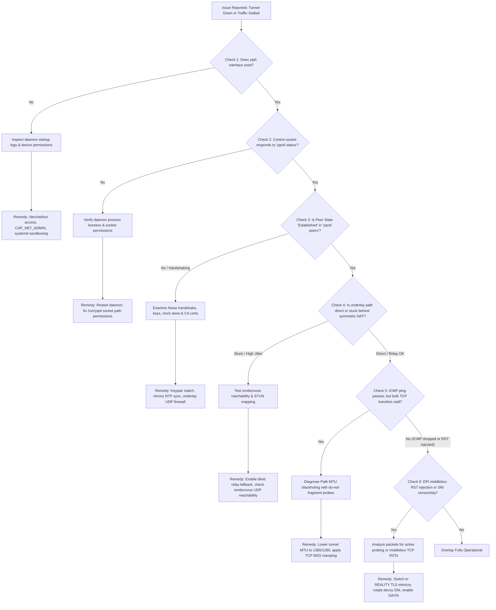

# yip Operational Troubleshooting & Diagnostic Runbook

This guide is the authoritative operational runbook, diagnostic workflow reference, and triage guide for `yip` and `yipd`. It covers end-to-end failure isolation across Linux networking primitives, kernel privileges, cryptographic handshakes, NAT traversal, path MTU discovery (PMTUD), and deep packet inspection (DPI) censorship filters.

For deployment and initial configuration, refer to:
- [01-getting-started.md](01-getting-started.md): System requirements, installation, and init service setups.
- [02-configuration.md](02-configuration.md): Comprehensive configuration reference (`yip.toml`).
- [03-architecture.md](03-architecture.md): Datapath pipeline, kernel bypass, and crypto engine.
- [04-security-and-threat-model.md](04-security-and-threat-model.md): Threat model, zero-trust admission, and censorship resistance.
- [05-benchmarking-and-performance.md](05-benchmarking-and-performance.md): Hardware tuning, microbenchmarks, and line-rate scaling.

---

## Table of Contents

- [1. Diagnostic Triage Tree](#1-diagnostic-triage-tree)
  - [Operational Triage Flowchart](#operational-triage-flowchart)
  - [Structured Diagnostic Workflow](#structured-diagnostic-workflow)
- [2. Five Core Failure Symptoms & Step-by-Step Remediation](#2-five-core-failure-symptoms--step-by-step-remediation)
  - [Symptom 1: Tunnel Interface (yip0) Fails to Appear / Permission Denied / EPERM](#symptom-1-tunnel-interface-yip0-fails-to-appear--permission-denied--eperm)
  - [Symptom 2: Peer Session Fails to Establish / Noise Handshake Timeout / 100% Loss](#symptom-2-peer-session-fails-to-establish--noise-handshake-timeout--100-loss)
  - [Symptom 3: NAT Traversal Stalls / Endpoint Stuck Behind Symmetric NAT](#symptom-3-nat-traversal-stalls--endpoint-stuck-behind-symmetric-nat)
  - [Symptom 4: Packet Loss, TCP Stalls, or Path MTU Blackholing](#symptom-4-packet-loss-tcp-stalls-or-path-mtu-blackholing)
  - [Symptom 5: DPI Middlebox RST Injection, Censorship Filtering, or Port Blocking](#symptom-5-dpi-middlebox-rst-injection-censorship-filtering-or-port-blocking)
- [3. CLI Diagnostic Command Cheat Sheet](#3-cli-diagnostic-command-cheat-sheet)
  - [Control Socket Telemetry (yipctl)](#control-socket-telemetry-yipctl)
  - [Systemd & Kernel Journal Telemetry](#systemd--kernel-journal-telemetry)
  - [Network & Driver Inspection (ethtool / bpftool / ss)](#network--driver-inspection-ethtool--bpftool--ss)
- [4. Operational Log Signature Reference](#4-operational-log-signature-reference)

---

## 1. Diagnostic Triage Tree

When diagnosing connectivity issues, do not guess or randomly toggle transport modes. Follow the structured triage paths in the decision tree below:

### Operational Triage Flowchart



### Structured Diagnostic Workflow

1. **Check 1: Interface & Permissions**
   Verify that the virtual network device (`yip0` or custom configured device) has been provisioned and brought up by the Linux kernel:
   ```bash
   ip -d link show yip0
   ```
   If the command outputs `Device "yip0" does not exist`, jump to [Symptom 1](#symptom-1-tunnel-interface-yip0-fails-to-appear--permission-denied--eperm).

2. **Check 2: Control Socket & Daemon Liveness**
   Confirm that `yipd` is running and its IPC domain socket is accepting commands:
   ```bash
   yipctl status
   ```
   If connection is refused or the socket `/run/yipd/yip.sock` is missing, inspect process status with `systemctl status yipd` and jump to [Symptom 1](#symptom-1-tunnel-interface-yip0-fails-to-appear--permission-denied--eperm).

3. **Check 3: Handshake & Peer Session Establishment**
   Inspect active peer sessions and cryptographic states:
   ```bash
   yipctl peers
   ```
   Check whether the state is `Established` or stuck in `Handshaking`/`Idle`. Check the `CERT` column to confirm whether zero-trust admission rejected the peer. If unestablished, proceed to [Symptom 2](#symptom-2-peer-session-fails-to-establish--noise-handshake-timeout--100-loss).

4. **Check 4: NAT Traversal & Endpoint Resolution**
   Inspect the active endpoint and transport mechanism reported by `yipctl peers --json`. If peers behind carrier-grade NAT (CGNAT) or symmetric NAT cannot discover each other via STUN hole-punching, proceed to [Symptom 3](#symptom-3-nat-traversal-stalls--endpoint-stuck-behind-symmetric-nat).

5. **Check 5: Datapath & MTU Health**
   Test basic round-trip latency and small packet transmission:
   ```bash
   yipctl ping <PEER_OVERLAY_IP>
   ping -6 -c 4 <PEER_OVERLAY_IP>
   ```
   If small ICMP packets succeed, but HTTP requests, SSH sessions, or iperf3 bulk transfers stall or freeze, proceed to [Symptom 4](#symptom-4-packet-loss-tcp-stalls-or-path-mtu-blackholing).

6. **Check 6: Anti-DPI & Censorship Circumvention**
   If UDP packets are completely dropped by stateful firewalls (such as the Great Firewall or corporate enterprise firewalls), or TCP connections to the tunnel endpoint receive injected TCP RST packets immediately after the TLS ClientHello, proceed to [Symptom 5](#symptom-5-dpi-middlebox-rst-injection-censorship-filtering-or-port-blocking).

---

## 2. Five Core Failure Symptoms & Step-by-Step Remediation

### Symptom 1: Tunnel Interface (yip0) Fails to Appear / Permission Denied / EPERM

#### Observed Indicators
- `yipd` exits immediately during startup with:
  ```text
  failed to open TUN device /dev/net/tun: Permission denied (os error 13)
  ```
  or:
  ```text
  failed to open TUN device /dev/net/tun: No such file or directory (os error 2)
  ```
- With AF_XDP or io_uring driver enabled:
  ```text
  Failed to allocate UMEM / io_uring ring: Cannot allocate memory (os error 12)
  ```
- Command `ip link show dev yip0` returns `Device "yip0" does not exist`.

#### Root Causes
1. **Missing or Misconfigured `/dev/net/tun` Device Node:** The character device `/dev/net/tun` (major 10, minor 200) does not exist in containerized environments or lacks read/write permissions for the daemon user.
2. **Missing Linux Capabilities:** Running unprivileged without `CAP_NET_ADMIN` (required for TUN/TAP device creation and routing table manipulation) and `CAP_NET_RAW` (required for raw packet captures). For AF_XDP and BPF offloads, `CAP_BPF`, `CAP_NET_ADMIN`, and `CAP_IPC_LOCK` are mandatory.
3. **Restrictive systemd Security Sandboxing:** A systemd service file configured with `ProtectDevices=yes` or `ProtectDevices=strict` isolates `/dev/` and prevents the process from opening `/dev/net/tun`.
4. **`RLIMIT_MEMLOCK` Exhaustion:** The kernel enforces a ceiling on locked memory (`mlock`). AF_XDP zero-copy ring buffers and UMEM memory pools require pinned physical pages that fail when `LimitMEMLOCK` is default (often 64 KiB).

#### Step-by-Step Remediation

##### Step 1.1: Verify Device Node Existence and Ownership
Ensure the TUN module is loaded and the device node exists with proper permissions:
```bash
# Verify kernel module
lsmod | grep tun || sudo modprobe tun

# Verify device node
ls -la /dev/net/tun
```
Expected output:
```text
crw-rw-rw- 1 root root 10, 200 Oct 26 12:00 /dev/net/tun
```
If missing, recreate it:
```bash
sudo mkdir -p /dev/net
sudo mknod /dev/net/tun c 10 200
sudo chmod 0666 /dev/net/tun
```

##### Step 1.2: Grant Explicit Linux Ambient Capabilities
If running `yipd` as a non-root dedicated service user (e.g., `yip`), assign capabilities directly to the binary using file capabilities:
```bash
sudo setcap 'cap_net_admin,cap_net_raw,cap_ipc_lock,cap_bpf+ep' /usr/local/bin/yipd
```
Verify assigned capabilities:
```bash
getcap /usr/local/bin/yipd
```

##### Step 1.3: Configure systemd Drop-In Overrides
If managing `yipd` via systemd, create a service override to adjust sandboxing and memory locks:
```bash
sudo systemctl edit yipd
```
Insert the following configuration block:
```ini
[Service]
# Allow access to /dev/net/tun and network devices
DeviceAllow=/dev/net/tun rw
ProtectDevices=no

# Linux capabilities required for TUN management and AF_XDP
CapabilityBoundingSet=CAP_NET_ADMIN CAP_NET_RAW CAP_BPF CAP_IPC_LOCK
AmbientCapabilities=CAP_NET_ADMIN CAP_NET_RAW CAP_BPF CAP_IPC_LOCK

# Unlock locked memory limit for AF_XDP UMEM registration & io_uring
LimitMEMLOCK=infinity

# Ensure runtime directory exists for control socket (/run/yipd/yip.sock)
RuntimeDirectory=yipd
RuntimeDirectoryMode=0755
```
Apply and restart the service:
```bash
sudo systemctl daemon-reload
sudo systemctl restart yipd
```

##### Step 1.4: Unlock Memory Limits in Interactive Shells
If launching `yipd` manually from a test shell with AF_XDP or io_uring:
```bash
ulimit -l unlimited
yipd /etc/yip/node.toml
```

---

### Symptom 2: Peer Session Fails to Establish / Noise Handshake Timeout / 100% Loss

#### Observed Indicators
- `yipctl peers` reports peer state `Handshaking` or `Idle`:
  ```text
  PEER                                    ENDPOINT               RTT      STATE         TRANSPORT
  a3f89b...e2                             198.51.100.10:443      -        Handshaking   raw-obf
  ```
- Overlay ping fails completely:
  ```text
  $ yipctl ping fd00:yip:a3f8::1
  ✗ ping fd00:yip:a3f8::1 timed out (no response)
  ```
- Daemon journal (`journalctl -u yipd`) displays:
  ```text
  peer_manager: failed to start handshake: Connection timed out
  peer_manager: stale/replayed Init refused (freshness gate)
  peer_manager: stale/replayed Init refused (boot floor gate)
  peer_manager: responder cert rejected
  ```

#### Root Causes
1. **Public Key / Node Address Mismatch:** Host A's configuration specifies a `public_key` that does not correspond to Host B's active private key.
2. **Clock Skew Exceeding Replay Window (> 60 Seconds):** The Noise-IK handshake encapsulates a TAI64N high-resolution timestamp. If either host has system clock drift exceeding the anti-replay window, the responder refuses the initial handshake message (`stale/replayed Init refused`).
3. **Firewall Blocking Underlay UDP Port:** The underlay transit port (default `443/udp`) is dropped by cloud security groups (AWS VPC Security Groups, GCP Firewall Rules), `iptables`, or `nftables`. Note that `yipd` natively selects port 443 to blend with HTTPS traffic and evade blocks on standard VPN ports.
4. **Zero-Trust CA Admission Failure:** If `[ca]` is enforced, a peer presenting an expired or untrusted Ed25519 node certificate is rejected immediately (`peer_manager: responder cert rejected`).

#### Step-by-Step Remediation

##### Step 2.1: Validate Cryptographic Public Keys and Derived Addresses
Check the public key on Host B:
```bash
# Extract public key from Host B's config or yipctl
yipctl status
```
Verify that Host B's hex public key matches the entry in Host A's `/etc/yip/node.toml`:
```toml
[[peer]]
public_key = "<HOST_B_HEX_PUBLIC_KEY>"
endpoint = "198.51.100.10:443"
```
Verify the self-certifying IPv6 address derived from the public key:
```bash
yipd --addr <HOST_B_HEX_PUBLIC_KEY>
```
Confirm this matches the IPv6 address you are pinging.

##### Step 2.2: Verify and Synchronize System Clocks (NTP)
Check system clock status and synchronization source:
```bash
timedatectl status
```
Ensure NTP service is active and the clock is synchronized (`System clock synchronized: yes`).
If using `chrony`:
```bash
chronyc tracking
chronyc sources -v
```
If using `systemd-timesyncd`:
```bash
systemctl restart systemd-timesyncd
journalctl -u systemd-timesyncd -e --no-pager
```

> [!IMPORTANT]
> The Noise handshake replay guard will unconditionally reject handshake packets if host clocks deviate by more than 60 seconds or if a timestamp is earlier than the node's boot floor timestamp (`boot_floor_ts`).

##### Step 2.3: Verify Underlay Transit Reachability with Packet Captures
On the listening host (Host B), inspect incoming UDP traffic on the listening port:
```bash
sudo tcpdump -nn -i any udp port 443
```
On the initiator host (Host A), send a manual probe or trigger a re-handshake:
```bash
# Test raw UDP reachability
nc -u -z -v -w 3 198.51.100.10 443
```
If no packets arrive in `tcpdump` on Host B:
- Check host firewall:
  ```bash
  sudo ufw status
  sudo iptables -L -n -v | grep 443
  sudo nft list ruleset | grep 443
  ```
- Allow incoming UDP port:
  ```bash
  sudo iptables -A INPUT -p udp --dport 443 -j ACCEPT
  ```

##### Step 2.4: Check Zero-Trust Certificate Admission
If using PKI node certificates, inspect certificate validity using `yip-ca`:
```bash
journalctl -u yipd -e --no-pager | grep "cert rejected"
```
Reissue or verify the node certificate against the root CA public key:
```bash
yip-ca verify --root-pub <ROOT_CA_KEY> --cert /etc/yip/node.crt
```

---

### Symptom 3: NAT Traversal Stalls / Endpoint Stuck Behind Symmetric NAT

#### Observed Indicators
- Endpoint displays dynamic address with rapid port hopping or fails to transition from STUN discovery to peer-to-peer data flow.
- `yipctl peers` shows:
  ```text
  PEER         ENDPOINT                 RTT    STATE         TRANSPORT
  7f2a1b...4c  192.0.2.1:49152 (STUN)   -      Handshaking   raw-obf
  ```
- Stderr log prints:
  ```text
  rendezvous: failed to discover public endpoint: STUN request timed out
  relay_client: resolving relay rendezvous.example.com:443 failed: Name or service not known
  ```

#### Root Causes
1. **Symmetric NAT / Address-and-Port-Dependent Mapping:** Both endpoints sit behind symmetric CGNAT gateways that allocate a new external port for every distinct destination IP/port combination. Direct UDP hole-punching mathematically fails under symmetric-to-symmetric topologies.
2. **Unreachable Rendezvous Server:** The configured rendezvous coordinator is unreachable due to DNS failure, port filtering, or server downtime.
3. **UDP Binding Timeout:** The NAT gateway drops UDP translation state after 30 seconds of inactivity because keepalive packets are disabled or set too infrequently.

#### Step-by-Step Remediation

##### Step 3.1: Inspect JSON Control Telemetry
Query detailed peer status via JSON:
```bash
yipctl peers --json
```
Inspect the output fields:
```json
{
  "public_key": "7f2a...",
  "endpoint": "198.51.100.5:41234",
  "node_addr": "fd00:yip:7f2a::1",
  "state": "Handshaking",
  "transport": "raw-obf",
  "rtt_ms": null
}
```

##### Step 3.2: Verify Rendezvous Server Reachability
Check whether the rendezvous server resolves and responds to UDP/TCP probes:
```bash
# Test DNS resolution
getent hosts rdv.example.com

# Test UDP reachability to rendezvous coordinator
nc -u -z -v -w 3 rdv.example.com 443
```

##### Step 3.3: Configure Persistent Keepalives
If sitting behind aggressive NAT state firewalls, enable persistent keepalive intervals in `node.toml`:
```toml
[network]
persistent_keepalive = 25  # Sends periodic keepalive every 25 seconds
```

##### Step 3.4: Enable Blind Relay Fallback
When direct UDP hole-punching fails due to symmetric NAT on both sides, configure blind relay transport fallback. `yip` automatically proxies encrypted ciphertext through the rendezvous node without revealing keys or payload:

> [!TIP] Clever Fox Tip: Nimble Tunneling Around Symmetric NATs
> Symmetric NATs try to trap you by randomizing outbound ports for every new destination. When direct hole-punching cannot find an open path, yip doesn't give up: it burrows through via blind relaying. The relay forwards your packets without ever possessing your session keys, keeping the data completely private while punching through otherwise impassable carrier networks.

```toml
[rendezvous]
server = "rdv.example.com:443"
relay_fallback = true

[transport]
kind = "relay"
relay_address = "rdv.example.com:443"
```
Restart `yipd` to establish the relay tunnel:
```bash
sudo systemctl restart yipd
yipctl peers
```
The transport column will now indicate `relay (blind)`.

---

### Symptom 4: Packet Loss, TCP Stalls, or Path MTU Blackholing

#### Observed Indicators
- ICMP pings succeed with minimal latency:
  ```bash
  ping -6 -c 3 fd00:yip:peer::1
  # 3 packets transmitted, 3 received, 0% packet loss, rtt min/avg/max = 24.1/24.3/24.5 ms
  ```
- SSH sessions connect, but freeze immediately when running `ls -la /usr/bin` or displaying large text output.
- HTTP/HTTPS downloads hang indefinitely after initial TLS negotiation.
- `iperf3 -c fd00:yip:peer::1` achieves zero throughput or drops to a few kilobytes per second.

#### Root Causes
1. **Encapsulation Overhead Exceeding Physical Underlay MTU:** Standard Ethernet MTU is 1500 bytes. Encapsulating overlay packets adds:
   - Outer IPv4 header: 20 bytes (or IPv6: 40 bytes)
   - Outer UDP header: 8 bytes
   - Obfuscation header: 11 bytes
   - `yip-wire` frame header: 15 bytes
   - Header authentication tag (SipHash-2-4): 8 bytes
   - Inner AEAD Poly1305 authentication tag: 16 bytes
   - **Total minimum overhead:** 78 bytes (IPv4) or 98 bytes (IPv6).
   If the overlay interface is set to `mtu = 1500`, transmitted packets will be `1578+` bytes, causing silent packet drops on transit paths that discard jumbo frames.
2. **Path MTU Discovery (PMTUD) Blackholing:** Upstream transit routers drop fragmented packets and filter ICMP `Fragmentation Needed` (ICMPv4 Type 3, Code 4) or `Packet Too Big` (ICMPv6 Type 2) messages. As a result, TCP senders never scale down their Maximum Segment Size (MSS).

#### Step-by-Step Remediation

##### Step 4.1: Perform Do-Not-Fragment Sweep to Identify Exact Path MTU
Run a binary search with do-not-fragment (`-M do` / `-M dont`) ICMP probes across the overlay:

```bash
# Test 1420 bytes payload + 8 byte ICMP header = 1428 bytes
ping -6 -M do -s 1420 fd00:yip:peer::1

# Step down until packets pass without packet loss
ping -6 -M do -s 1360 fd00:yip:peer::1
ping -6 -M do -s 1280 fd00:yip:peer::1
```
Notice the largest payload size $S$ that completes with 0% loss. The maximum safe overlay MTU is $S + 8$ (for ICMPv6 header).

##### Step 4.2: Configure Conservative Overlay MTU in yip Configuration
Open `/etc/yip/node.toml` and set a safe MTU:

```toml
[interface]
name = "yip0"
# Recommended safe MTU for standard Ethernet (1500 - 80 = 1420)
# Use 1360 for PPPoE (1492) or cloud VPCs (GCP 1460)
# Use 1280 for cellular / mobile / heavily encapsulated underlays
mtu = 1360
```
Or apply dynamically to the running interface:
```bash
sudo ip link set dev yip0 mtu 1360
```

##### Step 4.3: Apply TCP MSS Clamping via Netfilter
To prevent TCP connections from negotiating segment sizes larger than the overlay tunnel MTU, clamp the TCP SYN MSS automatically at the firewall:

###### Using iptables:
```bash
# Clamp MSS for traffic traversing the yip0 interface
sudo iptables -t mangle -A FORWARD -o yip0 -p tcp --tcp-flags SYN,RST SYN -j TCPMSS --clamp-mss-to-pmtu
sudo ip6tables -t mangle -A FORWARD -o yip0 -p tcp --tcp-flags SYN,RST SYN -j TCPMSS --clamp-mss-to-pmtu

# Clamp MSS for locally generated traffic
sudo iptables -t mangle -A POSTROUTING -o yip0 -p tcp --tcp-flags SYN,RST SYN -j TCPMSS --clamp-mss-to-pmtu
sudo ip6tables -t mangle -A POSTROUTING -o yip0 -p tcp --tcp-flags SYN,RST SYN -j TCPMSS --clamp-mss-to-pmtu
```

###### Using nftables:
```nft
table inet filter {
    chain forward {
        type filter hook forward priority mangle; policy accept;
        oifname "yip0" tcp flags syn tcp option maxseg size set rt mtu
    }
}
```

##### Step 4.4: Verify Forward Error Correction Recovery
Check if Reed-Solomon FEC is actively recovering loss caused by marginal MTU fragmentation:
```bash
yipctl peers
```
Examine `FEC PARITY` and `RECOVERED` counters. If `RECOVERED` is incrementing rapidly alongside high `FEC RATIO`, packet loss is occurring in transit and being reconstructed by vector SIMD Galois field arithmetic.

---

### Symptom 5: DPI Middlebox RST Injection, Censorship Filtering, or Port Blocking

#### Observed Indicators
- Connection to remote node works for several seconds or minutes, then suddenly drops completely with zero inbound packets.
- TCP connections reset with `Connection reset by peer` immediately after the initial TLS ClientHello handshake.
- Active probing detected in daemon logs:
  ```text
  relay_tls: listener received non-REALITY probe from 203.0.113.88: fallback triggered
  relay_client(reality): REALITY handshake to gateway.icloud.com timed out
  ```
- DPI engines (e.g., nDPI, Suricata, Zeek) classify wire traffic as `Unknown / Suspicious Protocol` or detect protocol entropy anomalies.

#### Root Causes
1. **Fixed UDP Port Blocking or Protocol Inspection:** While `yipd` natively binds port `443` to blend with HTTPS/QUIC traffic and evade standard VPN port blocks (like `51820`), restrictive censors or deep packet inspection middleboxes may drop raw UDP on port 443 unless it conforms to standard QUIC handshakes, or filter non-standard UDP protocols entirely.
2. **Decoy Domain SNI Mismatch or Target Blocked:** When using TLS / REALITY mimicry (`[transport] kind = "tls"`), the configured `reality_sni` domain is blocked, does not support TLS 1.3, or negotiates an unexpected ALPN.
3. **Active Prober Detection:** Censors replay captured handshakes or probe open ports with random payloads. Without REALITY authorization, unauthorized probes reveal the daemon.
4. **Traffic Analysis & Flow Shaping Heuristics:** Advanced DPI middleboxes detect packet size distributions, burst entropy, and inter-arrival timing patterns consistent with encrypted tunnels.

#### Step-by-Step Remediation

##### Step 5.1: Test REALITY Decoy Domain Reachability
Verify that the decoy domain specified in your configuration supports TLS 1.3 and is directly reachable from the client host:
```bash
curl -Iv https://gateway.icloud.com
```
Ensure that:
1. HTTP status code is valid (e.g., `200 OK` or `404 Not Found`).
2. Protocol is negotiated as TLS 1.3 (`SSL connection using TLSv1.3`).
3. Certificate is issued by a major public Certificate Authority.

If the decoy domain is unreachable or throttled in the client's geographic region, pick an alternate high-reputation domain (e.g., `swdist.apple.com`, `dl.google.com`, `cdnjs.cloudflare.com`).

##### Step 5.2: Switch Transport Mode to REALITY TLS Mimicry with uTLS Fingerprinting
Update `/etc/yip/node.toml` to disguise tunnel traffic as standard browser HTTPS using BoringSSL and uTLS ClientHello mimicry:

```toml
[transport]
kind = "tls"
listen = "0.0.0.0:443"

[obfuscation]
traffic_defense = "balanced"  # Enables DAITA packet padding

[transport.reality]
enabled = true
decoy_sni = "gateway.icloud.com"
dest = "gateway.icloud.com:443"
short_ids = ["0123456789abcdef"]
public_key = "<REALITY_SERVER_PUBKEY>"
utls_fingerprint = "chrome_120"  # Matches modern Chromium JA3/JA4 fingerprints and GREASE extensions
```
When an unauthenticated scanner or DPI prober connects to port `443`, `yipd` transparently proxies the TLS stream directly to `gateway.icloud.com:443`. The scanner sees a valid, authentic Apple TLS 1.3 certificate chain and terminates cleanly without detecting the hidden tunnel.

If a censor's active heuristic filter blacklists outdated ClientHello extension suites, update `utls_fingerprint = "chrome_120"` or rotate to a browser profile that generates matching JA3/JA4 fingerprints with RFC 8701 GREASE values.

##### Step 5.3: Enable Dynamic Adaptive Traffic Shaping (DAITA)
To prevent statistical machine learning classification (e.g., Random Forest or CNN models classifying traffic by packet size and timing):

```toml
[obfuscation]
# Options: "disabled", "balanced" (DAITA), "aggressive" (constant bitrate)
traffic_defense = "balanced"
pad_to_lengths = [128, 512, 1024, 1400]
chaff_prob = 0.05  # 5% dummy traffic injection
```

##### Step 5.4: Validate Against the Local Multi-Engine DPI Oracle
Before deploying into production in hostile network environments, test your traffic capture against the repository's automated DPI test oracle:
```bash
./bin/yipd/tests/run-multi-dpi-oracle.sh /usr/local/bin/yipd ndpiReader /tmp/dpi-results
```
Verify that all four inspection engines (nDPI, tshark, Suricata, Zeek) classify the traffic as ordinary TLS 1.3 (`TLS / HTTPS`) with zero signature alerts:
```text
[PASS] nDPI: classified as TLS.iCloud / TLS.Web
[PASS] tshark: valid TLS 1.3 record framing observed
[PASS] suricata: zero anomaly alerts triggered
```

---

## 3. CLI Diagnostic Command Cheat Sheet

The `yipctl` command-line utility communicates directly with the running `yipd` instance via its local UNIX domain socket (`/run/yipd/yip.sock` or fallback `/tmp/yipd.sock`).

### Control Socket Telemetry (`yipctl`)

| Command | Description |
| :--- | :--- |
| `yipctl status` | Displays daemon version, device name, self-certifying IPv6 address, connected peer count, and uptime. |
| `yipctl status --json` | Outputs machine-readable status JSON for monitoring integration (Prometheus, Telegraf, Zabbix). |
| `yipctl peers` | Displays formatted table of all peers: public key, endpoint IP, RTT, connection state, transport type, and FEC statistics. |
| `yipctl peers --json` | Outputs full array of peer objects with byte and packet counters. |
| `yipctl top` | Launches an interactive, curses-style real-time dashboard updating every 500 ms with bandwidth and FEC recovery graphs. |
| `yipctl top -i 200` | Real-time ANSI telemetry updating at a custom refresh interval (e.g., 200 ms). |
| `yipctl ping <PEER>` | Dispatches an internal end-to-end latency probe through the active transport pipeline to an overlay IPv6 address. |
| `yipctl peer add <KEY> <ENDPOINT> <TRANSPORT>` | Dynamically admits a peer into the active routing table without restarting `yipd`. |
| `yipctl peer rm <KEY>` | Evicts a peer from the runtime table and immediately tears down active session epochs. |
| `yipctl peer set-transport <KEY> <TRANSPORT>` | Dynamically hot-swaps transport protocol (`raw-obf`, `quic`, `tls`, `relay`). |
| `yipctl --addr <HEX_PUBKEY>` | Offline derivation tool: calculates the canonical self-certifying `fd00:yip::/64` mesh address from an Ed25519 public key. |
| `yipctl --genkey` | Offline key generation: outputs a cryptographically secure 256-bit private/public keypair. |

#### Example: `yipctl status` Output
```text
● yipd v0.0.0
  Device:     yip0
  Mesh IPv6:  fd00:yip:5a71:2c94:83bb:67ff:fe12:3456
  CA Gating:  Enforced (Root Ed25519): Zero-Trust Admission
  Uptime:     18h 42m 15s
  Peers:      3 active
```

#### Example: `yipctl peers` Output
```text
PEER                                    ENDPOINT               RTT      STATE         TRANSPORT        CERT        TX / RX                  FEC PARITY   RECOVERED
5a712c94...123456                      198.51.100.22:443      18ms     Established   raw-obf          CA Valid    1.42 GB / 3.81 GB        20%          1,482
e4b1029c...890123                      203.0.113.50:443       32ms     Established   tls (reality)    CA Valid    412 MB / 890 MB          15%          319
90fa3128...456789                      192.0.2.80:443         -        Handshaking   relay            CA Valid    12 KB / 0 B              0%           0
```

---

### Systemd & Kernel Journal Telemetry

| Command | Purpose |
| :--- | :--- |
| `journalctl -u yipd -f` | Follow live daemon log messages in real-time. |
| `journalctl -u yipd -e --no-pager` | Jump to the most recent errors and crash traces. |
| `journalctl -u yipd -S "1 hour ago" \| grep -i "error"` | Filter errors occurring within the past hour. |
| `systemctl restart yipd` | Restart the daemon and reinitialize devices. |
| `systemctl status yipd` | Check daemon PID, memory usage, cgroup limits, and exit codes. |

---

### Network & Driver Inspection (`ethtool` / `bpftool` / `ss`)

#### AF_XDP & Driver Queue Telemetry
When running high-performance AF_XDP zero-copy mode (`[driver] kind = "af_xdp"`), verify kernel queue counters and BPF attachment:

```bash
# Verify XDP BPF program attached to physical NIC
ip link show dev eth0

# Inspect per-queue packet counters and dropped buffers
ethtool -S eth0 | grep -E "rx_packets|tx_packets|xdp"

# Dump attached BPF maps and UMEM registration state
sudo bpftool map list
sudo bpftool net list
```

#### Socket & Port Binding Verification
Verify that `yipd` has bound the expected underlay UDP/TCP ports:

```bash
# Check listening UDP sockets
ss -ulpn | grep yipd

# Check listening TCP sockets (for TLS / REALITY listener)
ss -tlpn | grep yipd
```

#### Routing Table & Address Verification
Ensure that the mesh IPv6 subnet is routed through `yip0`:

```bash
# Verify interface IP
ip -6 addr show dev yip0

# Verify overlay routing table entry
ip -6 route show dev yip0
# Expected: fd00:yip::/64 dev yip0 proto kernel metric 256 pref medium
```

---

## 4. Operational Log Signature Reference

The table below maps exact log output patterns emitted by `yipd` and its subsystems to immediate operational root causes and corrective actions:

| Log Signature | Subsystem | Root Cause | Immediate Action |
| :--- | :--- | :--- | :--- |
| `failed to open TUN device /dev/net/tun: Permission denied` | `yip-device` | Missing `CAP_NET_ADMIN` or incorrect permissions on `/dev/net/tun`. | Run `sudo chmod 0666 /dev/net/tun` or set `setcap 'cap_net_admin+ep' yipd`. |
| `Failed to allocate UMEM / io_uring ring: Cannot allocate memory` | `yip-io` | `RLIMIT_MEMLOCK` limit too low for zero-copy memory pinning. | Set `LimitMEMLOCK=infinity` in systemd service or run `ulimit -l unlimited`. |
| `peer_manager: stale/replayed Init refused (freshness gate)` | `peer_manager` | Peer's handshake timestamp is earlier than or equal to the last accepted timestamp (clock skew or replay attack). | Sync clocks using `chronyc -a makestep` or restart `systemd-timesyncd`. |
| `peer_manager: stale/replayed Init refused (boot floor gate)` | `peer_manager` | Peer's timestamp is older than local node boot timestamp. | Verify remote host system clock is not set to epoch zero or running behind. |
| `peer_manager: responder cert rejected` | `peer_manager` | Remote node certificate failed Ed25519 root CA signature verification or has expired. | Reissue peer certificate with `yip-ca` or verify root public key configuration. |
| `peer_manager: failed to start handshake: Connection timed out` | `peer_manager` | UDP packets dropped by intermediate firewall or endpoint IP unreachable. | Check security groups; test reachability with `nc -u -z -v <ip> <port>`. |
| `relay_client: resolving relay <host>:<port> failed` | `relay_client` | DNS lookup failed for configured rendezvous server. | Verify `/etc/resolv.conf`, test with `dig +short <host>`, or use explicit IP. |
| `relay_client(reality): REALITY handshake to <sni> failed` | `relay_client` | Decoy SNI domain rejected connection, does not support TLS 1.3, or altered key. | Test decoy with `curl -Iv https://<sni>` or choose an alternative high-reputation domain. |
| `relay_client: socketpair backpressure, dropping a datagram` | `relay_client` | Dataplane event loop cannot keep pace with ingress relay socket rate. | Enable CPU core pinning or increase channel ring buffer capacity. |
| `warning: failed to set mtu <mtu> on <dev>` | `tunnel` | Configured MTU exceeds physical parent interface MTU or disallowed by kernel. | Ensure MTU is $\ge 576$ and $\le$ physical link MTU; run `ip link set dev <dev> mtu <mtu>`. |
| `dataplane ingress: deframe error` | `dataplane` | Corrupted packet, underlay MTU truncation, or mismatched SipHash authentication key. | Check MTU sizing; confirm `[auth]` secret keys match between nodes. |
| `dataplane ingress: open error` | `dataplane` | ChaCha20-Poly1305 AEAD decryption failure; packet tampered with or desynchronized key epoch. | Trigger handshake rekey via `yipctl ping <peer>`. |

---

## Next Steps

- If your tunnel is operational but performance requires optimization, consult [05-benchmarking-and-performance.md](05-benchmarking-and-performance.md) for CPU affinity and AF_XDP tuning.
- For complete syntax and advanced directives for all configuration blocks, see [02-configuration.md](02-configuration.md).
- To understand packet layout, state machines, and zero-trust protocol primitives, review [03-architecture.md](03-architecture.md) and [04-security-and-threat-model.md](04-security-and-threat-model.md).
