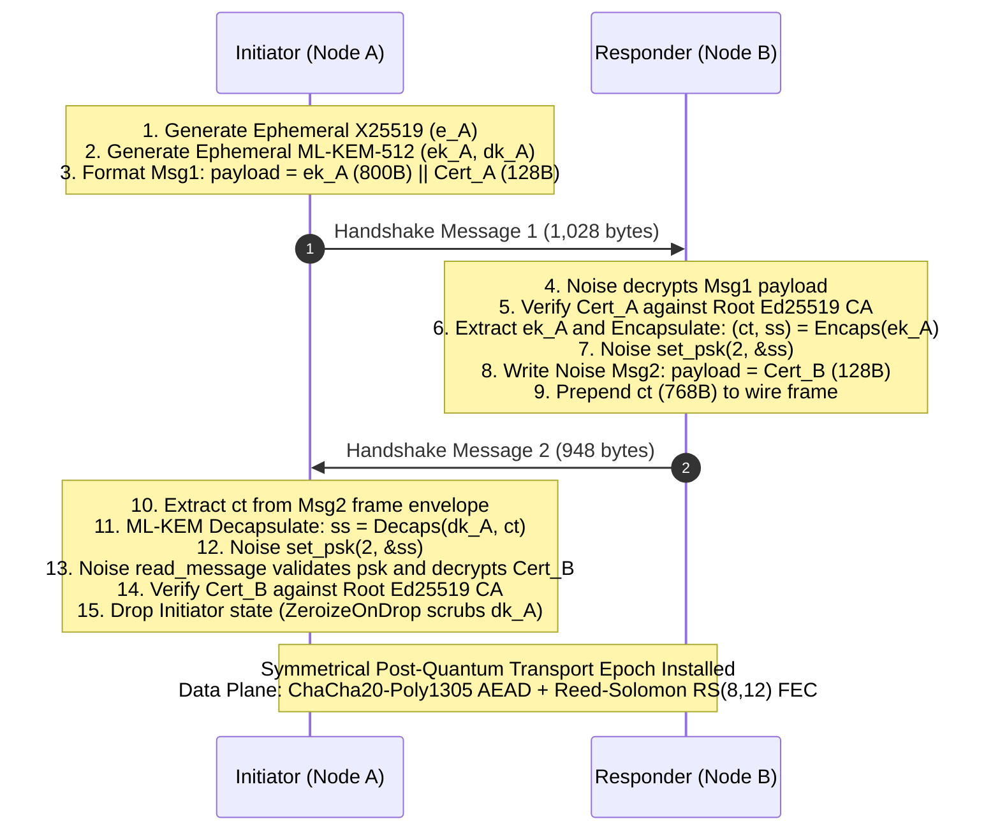

# Design Specification: Post-Quantum Hybrid Handshake (Noise-IKpsk2 + ML-KEM-512)

**Author:** Zoa Hickenlooper  
**Date:** 2026-10-20  
**Target Milestone:** Issue #9 (Part 9b)  
**Status:** Approved with Audit Resolutions  

---

## 1. Executive Summary

`yip` currently establishes transport sessions using classical Noise-IK (`Noise_IK_25519_ChaChaPoly_BLAKE2s`). While cryptographically sound against classical attackers, classical Diffie-Hellman exchanges over Curve25519 are vulnerable to "Harvest-Now, Decrypt-Later" adversary strategies where encrypted traffic is archived today to be decrypted by future Cryptanalytically Relevant Quantum Computers (CRQCs) using Shor's algorithm.

This specification details the transition of `yip`'s cryptographic handshake to a **Post-Quantum Hybrid Key Exchange** utilizing **`Noise_IKpsk2_25519_ChaChaPoly_BLAKE2s`** paired with **ML-KEM-512** (FIPS 203 / Kyber).

The design satisfies three non-negotiable operational requirements:
1. **Single-Datagram Fit**: Both handshake messages fit comfortably inside `OBF_MTU_BUDGET = 1200` bytes (Msg 1 = 1,028 bytes, Msg 2 = 948 bytes), completely avoiding IP fragmentation, chunking overhead, and packet loss amplification on lossy WAN links.
2. **Deadlock-Free Noise-IKpsk2 Protocol Execution**: Message 2 places the public ML-KEM-512 ciphertext ($ct$, 768B) in the outer framing envelope before the `snow` token sequence (`e, ee, se, psk`), allowing the Initiator to decapsulate $ss$ and invoke `handshake_state.set_psk(2, &ss)` *before* `read_message` executes the `psk` mix.
3. **Dual-Layer Defense**: Session keys are derived via HKDF over *both* classical X25519 Diffie-Hellman secrets and ML-KEM-512 post-quantum shared secrets. Breaking the session requires breaking *both* discrete logarithms and the Module Learning with Errors (MLWE) lattice problem simultaneously.

---

## 2. Cryptographic Protocol Specification

### 2.1 Noise Protocol Parameter Set
The Noise Protocol Framework parameter string is:
```text
Noise_IKpsk2_25519_ChaChaPoly_BLAKE2s
```
* **Pattern**: `IK` (Initiator knows Responder static public key upfront; authenticates both sides in 1 round trip).
* **Modifier**: `psk2` (Pre-Shared Key mixed into chaining key and transcript hash at the end of Message 2).
* **DH Function**: `25519` (X25519 scalar multiplication, 32-byte public keys / shared secrets).
* **Cipher**: `ChaChaPoly` (ChaCha20 stream cipher with Poly1305 MAC).
* **Hash Function**: `BLAKE2s` (256-bit cryptographic hash function).

### 2.2 Wire Message Layout & Datagram Budget

```text
Message 1 (Initiator -> Responder):
+------------------------------------------------------------------------+
| Header (4B) | Ephemeral e (32B) | Encrypted Static s (48B)            |
| Encrypted Payload: ML-KEM-512 Encapsulation Key ek (800B)              |
|                    Member Certificate (128B)                          |
|                    Poly1305 Auth Tag (16B)                            |
+------------------------------------------------------------------------+
Total Wire Size: 1,028 bytes (172 bytes headroom under 1,200 MTU budget)

Message 2 (Responder -> Initiator):
+------------------------------------------------------------------------+
| Header (4B) | ML-KEM-512 Ciphertext ct (768B)                         |
| Noise Msg 2: Ephemeral e (32B)                                         |
|              Encrypted Member Certificate (128B)                       |
|              Poly1305 Auth Tag (16B)                                   |
+------------------------------------------------------------------------+
Total Wire Size: 948 bytes (252 bytes headroom under 1,200 MTU budget)
```

### 2.3 Post-Quantum Key Encapsulation (ML-KEM-512)
* Standard: **FIPS 203 (ML-KEM)** / Kyber-512 via RustCrypto `ml-kem = { version = "0.3", features = ["zeroize"] }`.
* Encapsulation Key ($ek$): 800 bytes.
* Decapsulation Key ($dk$): 1,632 bytes (stored in volatile zeroized memory).
* Ciphertext ($ct$): 768 bytes.
* Shared Secret ($ss$): 32 bytes.
* Security Level: NIST Security Category 1 (equivalent to AES-128 against classical and quantum cryptanalysis, $\ge 2^{140}$ quantum gate operations).

---

## 3. Handshake Flow & State Machine



### 3.1 Step-by-Step Operations

1. **Initiator Setup (Msg 1)**:
   * Initiator initializes `snow::Builder::new("Noise_IKpsk2_25519_ChaChaPoly_BLAKE2s")`.
   * Initiator generates ML-KEM-512 keypair $(ek_A, dk_A)$ via `ml_kem::MlKem512::generate(&mut rng)`. $dk_A$ is wrapped in `Box<zeroize::Zeroizing<DecapsulationKey<MlKem512Params>>>`.
   * Initiator builds Msg 1 payload: `[ek_A (800B) || Cert_A (128B)]`.
   * `snow` executes `-> e, es, s, ss`, encrypting the payload. Total datagram: 1,028 bytes.

2. **Responder Processing & Response (Msg 2)**:
   * Responder decrypts Msg 1 payload via `read_message`.
   * Responder extracts and verifies `Cert_A` using Root CA public key. If invalid or expired, abort.
   * Responder extracts `ek_A` (800 bytes).
   * Responder calls `ml_kem::MlKem512::encapsulate(&ek_A, &mut rng)` yielding $(ct, ss)$.
   * Responder calls `handshake_state.set_psk(2, &ss)`.
   * Responder writes Noise Msg 2 with payload `Cert_B (128B)`.
   * Responder frames outbound packet as: `[Header (4B) || ct (768B) || Noise Msg 2 (176B)]`. Total datagram: 948 bytes.

3. **Initiator Processing & Finalization**:
   * Initiator receives Msg 2 datagram (948 bytes).
   * Initiator parses outer framing: slices `msg2[4..772]` to extract $ct$ (768 bytes).
   * Initiator decapsulates $ss = \text{Decaps}(dk_A, ct)$.
   * Initiator calls `handshake_state.set_psk(2, &ss)`.
   * Initiator passes `msg2[772..]` to `handshake_state.read_message(...)`.
   * `snow` evaluates `<- e, ee, se, psk`, mixing $ss$ into the chaining key and validating the Poly1305 MAC over `Cert_B`.
   * Initiator verifies `Cert_B`.
   * Both sides call `into_transport_mode()` / `split()`. $dk_A$ is automatically zeroized when `Handshake::Initiator` drops.

---

## 4. Periodic Session Rekey Integration (120-Second Rotation)

The post-quantum hybrid handshake is directly bound to `yipd`'s 120-second session rekey rotation mechanism:
* **Fresh Ephemerals**: Every rekey cycle generates a brand-new classical X25519 ephemeral *and* a brand-new ML-KEM-512 ephemeral keypair.
* **Forward Secrecy**: Even if a physical node's memory is dumped hours later, past session traffic cannot be decrypted because all ephemeral $dk$ instances were zeroized upon epoch installation.
* **Transient Memory Footprint**: In-flight `dk_A` instances add only 1,632 bytes per active rekeying peer. `Box<Zeroizing<...>>` ensures the `PeerState` enum remains small on the stack.
* **Zero-Downtime Epoch Overlap**: Outgoing traffic transitions immediately to the new epoch; incoming traffic continues to accept the old epoch for 15 seconds to drain network inflight packets.

---

## 5. Security & Threat Modeling

1. **Adversary with Cryptanalytically Relevant Quantum Computer (CRQC)**:
   * Classical X25519 discrete logs are cracked.
   * The Noise `ck` retains entropy from the ML-KEM-512 shared secret $ss$.
   * Derivation of transport keys remains computationally infeasible ($\ge 2^{140}$ quantum operations).
2. **Adversary Manipulating Ciphertext ($ct$)**:
   * Under ML-KEM-512's Fujisaki-Okamoto transform (FIPS 203 implicit rejection), modified ciphertext produces a deterministic pseudorandom $ss$ that does not match the responder's secret.
   * `MixKeyAndHash(ss)` produces a mismatched AEAD key, causing Noise Msg 2's Poly1305 tag over `Cert_B` to fail verification immediately. No timing leak is exposed.
3. **Replay Attacks**:
   * Handshake messages reuse `yip`'s monotonic timestamp window and anti-replay epoch cache. Replays are dropped at the border.

---

## 6. Implementation & Verification Plan

### 6.1 Affected Crates
* `crates/yip-crypto`:
  * Ensure `ml-kem = { version = "0.3", features = ["zeroize"] }` is configured.
  * Update `NOISE_PARAMS` to `"Noise_IKpsk2_25519_ChaChaPoly_BLAKE2s"`.
  * Update `Handshake::initiator`, `Handshake::responder`, and `Handshake::finalize_initiator`.
* `bin/yipd`:
  * Update handshake buffer sizing constants to accommodate 1,028-byte Msg 1 and 948-byte Msg 2.
  * Verify `OBF_MTU_BUDGET = 1200` headroom and relay forwarding buffers.
  * Wire PQ rekey state machine into `peer_manager`.

### 6.2 Testing Requirements
* **Unit Tests**:
  * Round-trip PQ handshake producing working transport sessions.
  * FIPS 203 Modulus Rejection: verify `EncapsKey` parsing rejects coefficients $\ge 3329$ (`0xFFF` in `ek_A[0..3]`).
  * Bit-tampered ciphertext implicit rejection and subsequent MAC failure.
  * Memory hygiene test confirming $dk$ zeroization via `ZeroizeOnDrop`.
  * Mutants verification: assert that skipping `set_psk` or zeroing $ss$ causes handshake divergence.
* **Integration Tests**:
  * Privileged network namespace tunnel test under 5% packet loss with active PQ encryption.
  * 10 consecutive fast-cadence rekey rotations over `poll` and `io_uring` drivers.
* **CI Quality Gates**:
  * Workspace line coverage $\ge 90.00\%$.
  * Zero Clippy warnings (`-D warnings`).
